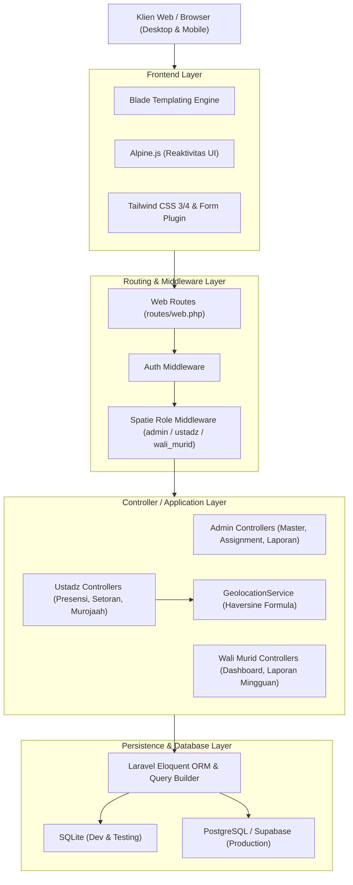
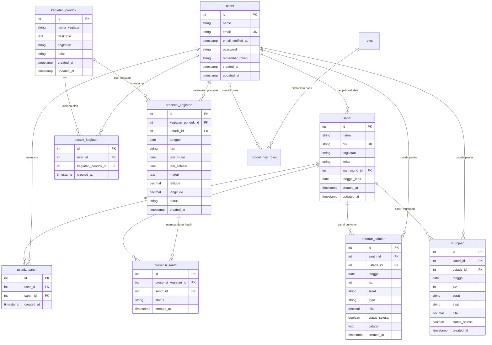

# Dokumentasi Sistem Informasi Administrasi PPTQ Ibnu Juraimi

Dokumentasi teknis menyeluruh untuk sistem administrasi akademik dan kepengasuhan Pondok Pesantren Tahfidzul Qur'an (PPTQ) Ibnu Juraimi Yogyakarta. Dokumen ini mencakup analisis arsitektur, daftar lengkap teknologi (*tech stack*), skema basis data (*database*), katalog kueri SQL/Eloquent komprehensif, logika bisnis, katalog *routing*, serta panduan instalasi dan *deployment*.

---

## Daftar Isi
1. [Ringkasan Eksekutif & Arsitektur Sistem](#1-ringkasan-eksekutif--arsitektur-sistem)
2. [Tech Stack Komprehensif](#2-tech-stack-komprehensif)
3. [Arsitektur Keamanan & Hak Akses (RBAC)](#3-arsitektur-keamanan--hak-akses-rbac)
4. [Skema Basis Data & Data Dictionary](#4-skema-basis-data--data-dictionary)
5. [Katalog Kueri Basis Data (Semua Query Aplikasi)](#5-katalog-kueri-basis-data-semua-query-aplikasi)
   - [5.1 Modul Autentikasi & Akun](#51-modul-autentikasi--profil)
   - [5.2 Modul Pengurus (Admin)](#52-modul-pengurus-admin)
   - [5.3 Modul Pengajar (Ustadz)](#53-modul-pengajar-ustadz)
   - [5.4 Modul Orang Tua (Wali Murid)](#54-modul-orang-tua-wali-murid)
6. [Layanan Geolocation & Formula Haversine](#6-layanan-geolocation--formula-haversine)
7. [Katalog Rute API & Web (Routing Matrix)](#7-katalog-rute-api--web-routing-matrix)
8. [Struktur Direktori Proyek](#8-struktur-direktori-proyek)
9. [Panduan Instalasi & Menjalankan Proyek](#9-panduan-instalasi--menjalankan-proyek)
10. [Panduan Deployment (Vercel & Supabase)](#10-panduan-deployment-vercel--supabase)

---

## 1. Ringkasan Eksekutif & Arsitektur Sistem

Sistem Informasi Administrasi PPTQ Ibnu Juraimi adalah aplikasi web terintegrasi yang dirancang untuk mengelola ekosistem pesantren tahfidz modern. Platform ini menghubungkan tiga pemangku kepentingan utama:

1. **Pengurus / Administrator (Admin):** Mengontrol data master (Santri, Ustadz, Wali Murid, Kegiatan Pondok), mengelola pemetaan/penugasan ustadz terhadap kegiatan dan santri binaan, serta memantau analitik laporan berkala pesantren.
2. **Pengajar (Ustadz):** Melakukan presensi kehadiran diri berbasis koordinat GPS (*geolocation* radius 150 meter), memvalidasi kehadiran santri binaan per tingkatan/kelas, serta mencatat capaian hafalan Al-Qur'an (Setoran Hafalan baru dan Murojaah).
3. **Orang Tua / Wali Santri (Wali Murid):** Memantau perkembangan akademik, riwayat kehadiran harian, grafik hafalan, dan murojaah santri secara *real-time* dari rumah.

### Diagram Arsitektur Tingkat Tinggi



---

## 2. Tech Stack Komprehensif

Sistem dibangun menggunakan susunan teknologi (*stack*) mutakhir berbasis ekosistem PHP dan JavaScript modern:

### 2.1 Backend Core
* **Bahasa Pemrograman:** PHP 8.3+ (Fitur: Typed Properties, Readonly Classes, Match Expressions, Attributes)
* **Framework Web:** Laravel 13.x (Laravel Framework 13.17 / Laravel 11 Skeleton Architecture)
* **Arsitektur:** Model-View-Controller (MVC) + Service Class Layer
* **Manajemen Dependensi:** Composer 2.x
* **Interaktif CLI:** Laravel Tinker 3.0, Laravel Pail 1.2.5 (Real-time log tailing)

### 2.2 Basis Data & Penyimpanan
* **Development Engine:** SQLite 3 (Cepat, *zero-configuration*, tersimpan pada `database/database.sqlite`)
* **Production Engine:** PostgreSQL 15+ (Dihosting pada Supabase Managed Database)
* **ORM:** Laravel Eloquent ORM & Laravel Database Query Builder
* **Session & Cache Driver:** Database Session (`sessions` table) / Array Cache / Cookie Store
* **Queue Connection:** Database / Sync driver

### 2.3 Frontend & UI/UX
* **View Engine:** Laravel Blade Templates
* **CSS Framework:** Tailwind CSS v3.1.0 dengan integrasi `@tailwindcss/vite`
* **Form Styling:** `@tailwindcss/forms`
* **CSS Preprocessor:** PostCSS 8.4 & Autoprefixer 10.4
* **Micro-Frontend Reactive State:** Alpine.js 3.4.2 (Digunakan untuk modal, interaksi dropdown, dan penanganan status form)
* **Asset Bundler:** Vite 8.0 (`laravel-vite-plugin` 3.1)
* **Desain Responsif:** Desain Mobile-First disesuaikan untuk perangkat smartphone ustadz & wali murid

### 2.4 Otentikasi & Otorisasi
* **Starter Kit:** Laravel Breeze 2.4 (Blade + Alpine stack)
* **Role-Based Access Control (RBAC):** Spatie Laravel Permission 8.1
* **Password Hashing:** Bcrypt Algorithmic Hashing (Round 12)
* **Proteksi Form:** Native Laravel CSRF Token Protection

### 2.5 Geolocation & Layanan Matematis
* **Radius Geofence:** Dihitung langsung menggunakan **Haversine Great-Circle Navigation Formula**
* **Akurasi Geospasial:** Derajat Desimal (Latitude: 10,7 / Longitude: 10,7)
* **Toleransi Radius Pesantren:** 150 Meter dari titik pusat pondok

### 2.6 Pengujian & Mutu Kode (QA)
* **Framework Pengujian:** PHPUnit 12.5.12
* **Mocking:** Mockery 1.6
* **Database Testing:** RefreshDatabase Trait (In-Memory / Isolation)
* **Code Linter & Formatter:** Laravel Pint 1.27
* **Data Faker:** FakerPHP 1.23

### 2.7 Deployment & Infrastruktur
* **Platform Hosting Serverless:** Vercel (Runtime `vercel-php@0.6.2`)
* **Static Assets:** `@vercel/static`
* **Serverless Entry Point:** `api/index.php` (Bridge ke `public/index.php`)

---

## 3. Arsitektur Keamanan & Hak Akses (RBAC)

Sistem menerapkan prinsip *Least Privilege* dengan memisahkan hak akses ke dalam 3 peran (*roles*):

| Role | Hak Akses Utama | Batasan Akses |
| :--- | :--- | :--- |
| `admin` | CRUD Master Santri, Ustadz, Wali Murid, Kegiatan; Penugasan Ustadz & Santri; Seluruh Laporan | Tidak mengisi presensi kegiatan atau mencatat hafalan harian santri |
| `ustadz` | Melakukan Geo-presensi, Mengisi Presensi Santri, Input Setoran Hafalan & Murojaah | Hanya dapat mengakses santri binaan dan kegiatan yang diampu |
| `wali_murid` | Memantau Dashboard Anak, Melihat Laporan Mingguan, Riwayat Kehadiran | Hanya dapat mengakses data santri yang memiliki `wali_murid_id` akun miliknya |

Pemeriksaan hak akses dilakukan secara berlapis:
1. **Route Level:** `middleware(['auth', 'role:admin'])` via Spatie Role Middleware.
2. **Controller Level:** Validasi kepemilikan data (misal: verifikasi bahwa santri terkait berada di dalam daftar `ustadz->santriBinaan()`, atau `santri->wali_murid_id === auth()->id()`).
3. **Database Level:** Foreign key cascade deletion dan constraint unique mencegah duplikasi data.

---

## 4. Skema Basis Data & Data Dictionary

### 4.1 Diagram Entitas Relasi (Entity-Relationship Diagram)



---

### 4.2 Spesifikasi Detail Tabel (Data Dictionary)

#### 1. Tabel `users`
Menyimpan identitas seluruh aktor pengguna sistem (Admin, Ustadz, Wali Murid).
* **Tabel:** `users`
* **Primary Key:** `id` (Auto-increment Integer)

| Kolom | Tipe Data | Nullable | Default | Keterangan & Batasan |
| :--- | :--- | :--- | :--- | :--- |
| `id` | `increments` (INTEGER) | Tidak | Auto | ID unik pengguna |
| `name` | `VARCHAR(255)` | Tidak | - | Nama lengkap pengguna / gelar |
| `email` | `VARCHAR(255)` | Tidak | - | Email unik untuk autentikasi (`UNIQUE`) |
| `email_verified_at` | `TIMESTAMP` | Ya | `NULL` | Waktu verifikasi email |
| `password` | `VARCHAR(255)` | Tidak | - | Hash sandi Bcrypt |
| `remember_token` | `VARCHAR(100)` | Ya | `NULL` | Token sesi remember me |
| `created_at` | `TIMESTAMP` | Ya | `NULL` | Waktu pendaftaran akun |
| `updated_at` | `TIMESTAMP` | Ya | `NULL` | Waktu pembaruan profil |

---

#### 2. Tabel `santri`
Menyimpan data santri yang sedang menempuh pendidikan di pondok pesantren.
* **Tabel:** `santri`
* **Primary Key:** `id` (Auto-increment Integer)

| Kolom | Tipe Data | Nullable | Default | Keterangan & Batasan |
| :--- | :--- | :--- | :--- | :--- |
| `id` | `increments` (INTEGER) | Tidak | Auto | ID primer santri |
| `nama` | `VARCHAR(255)` | Tidak | - | Nama lengkap santri |
| `nis` | `VARCHAR(50)` | Tidak | - | Nomor Induk Santri (`UNIQUE`) |
| `tingkatan` | `VARCHAR(20)` | Tidak | `'tsanawiyah'` | ENUM: `tsanawiyah`, `aliyah`, `takhassus` |
| `kelas` | `VARCHAR(50)` | Ya | `NULL` | Kelas akademik (misal: '7', '8', '9', '10', '11', '12', 'Takhassus') |
| `wali_murid_id` | `INTEGER` | Ya | `NULL` | Foreign Key ke `users.id` (Relasi: `ON DELETE SET NULL`) |
| `tanggal_lahir` | `DATE` | Ya | `NULL` | Tanggal lahir santri |
| `created_at` | `TIMESTAMP` | Ya | `NULL` | Waktu pencatatan data santri |
| `updated_at` | `TIMESTAMP` | Ya | `NULL` | Waktu update data santri |

---

#### 3. Tabel `kegiatan_pondok`
Menyimpan daftar kegiatan keagamaan, tahfidz, kajian, dan aktivitas pondok pesantren.
* **Tabel:** `kegiatan_pondok`
* **Primary Key:** `id` (Auto-increment Integer)

| Kolom | Tipe Data | Nullable | Default | Keterangan & Batasan |
| :--- | :--- | :--- | :--- | :--- |
| `id` | `increments` (INTEGER) | Tidak | Auto | ID primer kegiatan |
| `nama_kegiatan` | `VARCHAR(255)` | Tidak | - | Judul kegiatan (contoh: Tahfidz Pagi, Kajian Kitab) |
| `deskripsi` | `TEXT` | Ya | `NULL` | Uraian dan tujuan kegiatan |
| `tingkatan` | `VARCHAR(20)` | Tidak | `'semua'` | Target: `semua`, `tsanawiyah`, `aliyah`, `takhassus` |
| `kelas` | `VARCHAR(20)` | Ya | `NULL` | Target spesifik kelas tertentu jika ada |
| `created_at` | `TIMESTAMP` | Ya | `NULL` | Waktu pembuatan kegiatan |
| `updated_at` | `TIMESTAMP` | Ya | `NULL` | Waktu perubahan data kegiatan |

---

#### 4. Tabel `ustadz_kegiatan` (Pivot Penugasan Kegiatan)
Menghubungkan Ustadz dengan kegiatan pondok yang diampunya.
* **Tabel:** `ustadz_kegiatan`
* **Primary Key:** `id` (Auto-increment Integer)
* **Index Unik:** `UNIQUE(user_id, kegiatan_pondok_id)`

| Kolom | Tipe Data | Nullable | Default | Keterangan & Batasan |
| :--- | :--- | :--- | :--- | :--- |
| `id` | `increments` (INTEGER) | Tidak | Auto | ID penugasan |
| `user_id` | `INTEGER` | Tidak | - | FK ke `users.id` (`ON DELETE CASCADE`) |
| `kegiatan_pondok_id` | `INTEGER` | Tidak | - | FK ke `kegiatan_pondok.id` (`ON DELETE CASCADE`) |
| `created_at` | `TIMESTAMP` | Tidak | `CURRENT_TIMESTAMP` | Waktu penugasan dibuat |

---

#### 5. Tabel `ustadz_santri` (Pivot Santri Binaan)
Menentukan daftar santri yang berada di bawah bimbingan tahfidz langsung oleh ustadz tertentu.
* **Tabel:** `ustadz_santri`
* **Primary Key:** `id` (Auto-increment Integer)
* **Index Unik:** `UNIQUE(user_id, santri_id)`

| Kolom | Tipe Data | Nullable | Default | Keterangan & Batasan |
| :--- | :--- | :--- | :--- | :--- |
| `id` | `increments` (INTEGER) | Tidak | Auto | ID pemetaan binaan |
| `user_id` | `INTEGER` | Tidak | - | FK ke `users.id` ustadz pembina (`ON DELETE CASCADE`) |
| `santri_id` | `INTEGER` | Tidak | - | FK ke `santri.id` santri binaan (`ON DELETE CASCADE`) |
| `created_at` | `TIMESTAMP` | Tidak | `CURRENT_TIMESTAMP` | Waktu penugasan binaan |

---

#### 6. Tabel `presensi_kegiatan`
Menyimpan sesi absensi kehadiran ustadz pada suatu kegiatan pondok beserta koordinat GPS.
* **Tabel:** `presensi_kegiatan`
* **Primary Key:** `id` (Auto-increment Integer)

| Kolom | Tipe Data | Nullable | Default | Keterangan & Batasan |
| :--- | :--- | :--- | :--- | :--- |
| `id` | `increments` (INTEGER) | Tidak | Auto | ID sesi presensi |
| `kegiatan_pondok_id` | `INTEGER` | Tidak | - | FK ke `kegiatan_pondok.id` (`ON DELETE CASCADE`) |
| `ustadz_id` | `INTEGER` | Tidak | - | FK ke `users.id` ustadz (`ON DELETE CASCADE`) |
| `tanggal` | `DATE` | Tidak | - | Tanggal pelaksanaan kegiatan |
| `hari` | `VARCHAR(20)` | Tidak | - | Hari (contoh: 'Senin', 'Selasa', dst.) |
| `jam_mulai` | `TIME` | Tidak | - | Jam dimulainya kegiatan (format HH:MM) |
| `jam_selesai` | `TIME` | Ya | `NULL` | Jam berakhirnya kegiatan |
| `materi` | `TEXT` | Ya | `NULL` | Materi/bahasan yang disampaikan |
| `latitude` | `DECIMAL(10, 7)` | Ya | `NULL` | Koordinat lintang posisi ustadz saat presensi |
| `longitude` | `DECIMAL(10, 7)` | Ya | `NULL` | Koordinat bujur posisi ustadz saat presensi |
| `status` | `VARCHAR(15)` | Tidak | `'pending'` | ENUM: `valid`, `invalid`, `pending` |
| `created_at` | `TIMESTAMP` | Tidak | `CURRENT_TIMESTAMP` | Waktu pencatatan sesi |

---

#### 7. Tabel `presensi_santri`
Mencatat status kehadiran masing-masing santri pada sesi kegiatan yang telah divalidasi ustadz.
* **Tabel:** `presensi_santri`
* **Primary Key:** `id` (Auto-increment Integer)
* **Index Unik:** `UNIQUE(presensi_kegiatan_id, santri_id)`

| Kolom | Tipe Data | Nullable | Default | Keterangan & Batasan |
| :--- | :--- | :--- | :--- | :--- |
| `id` | `increments` (INTEGER) | Tidak | Auto | ID kehadiran santri |
| `presensi_kegiatan_id` | `INTEGER` | Tidak | - | FK ke `presensi_kegiatan.id` (`ON DELETE CASCADE`) |
| `santri_id` | `INTEGER` | Tidak | - | FK ke `santri.id` (`ON DELETE CASCADE`) |
| `status` | `VARCHAR(10)` | Tidak | `'alpha'` | ENUM: `hadir`, `izin`, `sakit`, `alpha` |
| `created_at` | `TIMESTAMP` | Tidak | `CURRENT_TIMESTAMP` | Waktu input kehadiran |

---

#### 8. Tabel `setoran_hafalan`
Mencatat capaian setoran penambahan hafalan baru Al-Qur'an (ziyadah) oleh santri.
* **Tabel:** `setoran_hafalan`
* **Primary Key:** `id` (Auto-increment Integer)

| Kolom | Tipe Data | Nullable | Default | Keterangan & Batasan |
| :--- | :--- | :--- | :--- | :--- |
| `id` | `increments` (INTEGER) | Tidak | Auto | ID setoran hafalan |
| `santri_id` | `INTEGER` | Tidak | - | FK ke `santri.id` (`ON DELETE CASCADE`) |
| `ustadz_id` | `INTEGER` | Tidak | - | FK ke `users.id` (`ON DELETE CASCADE`) |
| `tanggal` | `DATE` | Tidak | - | Tanggal penyetoran |
| `juz` | `INTEGER` | Tidak | - | Juz ke-1 sampai 30 |
| `surat` | `VARCHAR(100)` | Tidak | - | Nama surat Al-Qur'an (misal: 'Al-Baqarah') |
| `ayat` | `VARCHAR(50)` | Tidak | - | Rentang ayat yang disetorkan (misal: '1-25') |
| `nilai` | `DECIMAL(5, 2)` | Ya | `NULL` | Nilai kualitas hafalan (0 - 100) |
| `status_selesai` | `TINYINT(1)` / `BOOLEAN` | Tidak | `0` | `1` jika tuntas, `0` jika perlu diulang |
| `catatan` | `TEXT` | Ya | `NULL` | Catatan tajwid / makhorijul huruf dari ustadz |
| `created_at` | `TIMESTAMP` | Tidak | `CURRENT_TIMESTAMP` | Waktu input data |

---

#### 9. Tabel `murojaah`
Mencatat riwayat pengulangan hafalan (murojaah) untuk menjaga kelancaran hafalan santri.
* **Tabel:** `murojaah`
* **Primary Key:** `id` (Auto-increment Integer)

| Kolom | Tipe Data | Nullable | Default | Keterangan & Batasan |
| :--- | :--- | :--- | :--- | :--- |
| `id` | `increments` (INTEGER) | Tidak | Auto | ID murojaah |
| `santri_id` | `INTEGER` | Tidak | - | FK ke `santri.id` (`ON DELETE CASCADE`) |
| `ustadz_id` | `INTEGER` | Tidak | - | FK ke `users.id` (`ON DELETE CASCADE`) |
| `tanggal` | `DATE` | Tidak | - | Tanggal pelaksanaan murojaah |
| `juz` | `INTEGER` | Tidak | - | Juz ke-1 sampai 30 |
| `surat` | `VARCHAR(100)` | Tidak | - | Nama surat Al-Qur'an |
| `ayat` | `VARCHAR(50)` | Tidak | - | Rentang ayat murojaah |
| `nilai` | `DECIMAL(5, 2)` | Ya | `NULL` | Nilai kelancaran (0 - 100) |
| `status_selesai` | `TINYINT(1)` / `BOOLEAN` | Tidak | `0` | `1` jika tuntas lancar, `0` jika belum |
| `created_at` | `TIMESTAMP` | Tidak | `CURRENT_TIMESTAMP` | Waktu input murojaah |

---

#### 10. Tabel Otorisasi Spatie (`roles`, `permissions`, `model_has_roles`, dll)
* `roles`: Menyimpan nama role (`admin`, `ustadz`, `wali_murid`) dengan guard `web`.
* `permissions`: Menyimpan nama permission sistem.
* `model_has_roles`: Menghubungkan model `App\Models\User` (`model_id`) dengan `role_id`.

#### 11. Tabel Sistem Laravel (`sessions`, `cache`, `jobs`, `password_reset_tokens`)
* `password_reset_tokens`: Menyimpan token reset sandi berbasis email pengguna.
* `sessions`: Menyimpan sesi pengguna jika `SESSION_DRIVER=database`.
* `cache` & `cache_locks`: Penyimpanan kunci cache sistem.
* `jobs`, `job_batches`, `failed_jobs`: Mengelola antrean pekerjaan asinkron (*asynchronous queue*).

---

## 5. Katalog Kueri Basis Data (Semua Query Aplikasi)

Berikut adalah katalog **seluruh kueri basis data** yang digunakan di dalam aplikasi, disajikan dalam bentuk kode **Eloquent ORM** dan terjemahan langsung ke **Raw SQL (ANSI/PostgreSQL/SQLite)**.

---

### 5.1 Modul Autentikasi & Profil

#### Q-AUTH-01: Pencarian Akun Pengguna saat Login
* **Tujuan:** Mengambil data user berdasarkan email untuk memvalidasi kredensial password.
* **Lokasi:** `App\Http\Requests\Auth\LoginRequest::authenticate()`
* **Eloquent ORM:**
  ```php
  User::where('email', $request->email)->first();
  ```
* **Raw SQL:**
  ```sql
  SELECT * FROM "users" 
  WHERE "email" = 'admin@pptq.test' 
  LIMIT 1;
  ```

#### Q-AUTH-02: Pengecekan Role Pengguna (Spatie HasRoles)
* **Tujuan:** Mengetahui peran (*role*) user untuk melakukan *routing* ke dashboard yang tepat.
* **Lokasi:** `routes/web.php` & `App\Http\Middleware\RoleMiddleware`
* **Eloquent ORM:**
  ```php
  $user->hasRole('admin');
  ```
* **Raw SQL:**
  ```sql
  SELECT "roles".* 
  FROM "roles" 
  INNER JOIN "model_has_roles" 
    ON "roles"."id" = "model_has_roles"."role_id" 
  WHERE "model_has_roles"."model_id" = 1 
    AND "model_has_roles"."model_type" = 'App\\Models\\User' 
    AND "roles"."name" = 'admin' 
  LIMIT 1;
  ```

#### Q-AUTH-03: Perbarui Profil Pengguna
* **Tujuan:** Memperbarui nama dan email pengguna yang sedang login.
* **Lokasi:** `App\Http\Controllers\ProfileController::update()`
* **Eloquent ORM:**
  ```php
  $request->user()->fill($request->validated());
  if ($request->user()->isDirty('email')) {
      $request->user()->email_verified_at = null;
  }
  $request->user()->save();
  ```
* **Raw SQL:**
  ```sql
  UPDATE "users" 
  SET "name" = 'Nama Baru', 
      "email" = 'emailbaru@pptq.test', 
      "email_verified_at" = NULL, 
      "updated_at" = '2026-11-03 03:00:00' 
  WHERE "id" = 1;
  ```

#### Q-AUTH-04: Penghapusan Akun Pengguna
* **Tujuan:** Menghapus akun user dan mengakhiri sesi.
* **Lokasi:** `App\Http\Controllers\ProfileController::destroy()`
* **Eloquent ORM:**
  ```php
  $user->delete();
  ```
* **Raw SQL:**
  ```sql
  DELETE FROM "users" WHERE "id" = 1;
  ```

---

### 5.2 Modul Pengurus (Admin)

#### Q-ADM-01: Statistik Kartu Metrik Dashboard Admin
* **Tujuan:** Mengumpulkan agregasi total santri, ustadz, kegiatan, wali murid, dan presensi hari ini.
* **Lokasi:** `App\Http\Controllers\Admin\DashboardController::index()`
* **Eloquent ORM:**
  ```php
  Santri::count();
  User::role('ustadz')->count();
  KegiatanPondok::count();
  User::role('wali_murid')->count();
  PresensiKegiatan::whereDate('tanggal', today())->count();
  ```
* **Raw SQL:**
  ```sql
  -- Total Santri
  SELECT COUNT(*) AS aggregate FROM "santri";

  -- Total Ustadz
  SELECT COUNT(*) AS aggregate 
  FROM "users" 
  INNER JOIN "model_has_roles" ON "users"."id" = "model_has_roles"."model_id" 
  INNER JOIN "roles" ON "roles"."id" = "model_has_roles"."role_id" 
  WHERE "roles"."name" = 'ustadz' AND "model_has_roles"."model_type" = 'App\\Models\\User';

  -- Total Kegiatan
  SELECT COUNT(*) AS aggregate FROM "kegiatan_pondok";

  -- Total Wali Murid
  SELECT COUNT(*) AS aggregate 
  FROM "users" 
  INNER JOIN "model_has_roles" ON "users"."id" = "model_has_roles"."model_id" 
  INNER JOIN "roles" ON "roles"."id" = "model_has_roles"."role_id" 
  WHERE "roles"."name" = 'wali_murid' AND "model_has_roles"."model_type" = 'App\\Models\\User';

  -- Presensi Hari Ini
  SELECT COUNT(*) AS aggregate 
  FROM "presensi_kegiatan" 
  WHERE DATE("tanggal") = '2026-11-03';
  ```

---

#### Q-ADM-02: Daftar Kegiatan Pondok dengan Hitungan Pengampu
* **Tujuan:** Mengambil daftar kegiatan pondok dengan filter tingkatan dan jumlah ustadz yang mengampu.
* **Lokasi:** `App\Http\Controllers\Admin\KegiatanPondokController::index()`
* **Eloquent ORM:**
  ```php
  $query = KegiatanPondok::withCount('ustadz')->latest();
  if ($request->filled('tingkatan')) {
      $query->where('tingkatan', $request->tingkatan);
  }
  $kegiatan = $query->paginate(15);
  ```
* **Raw SQL:**
  ```sql
  SELECT "kegiatan_pondok".*, 
    (SELECT COUNT(*) 
     FROM "users" 
     INNER JOIN "ustadz_kegiatan" ON "users"."id" = "ustadz_kegiatan"."user_id" 
     WHERE "kegiatan_pondok"."id" = "ustadz_kegiatan"."kegiatan_pondok_id"
    ) AS "ustadz_count" 
  FROM "kegiatan_pondok" 
  WHERE "tingkatan" = 'tsanawiyah' 
  ORDER BY "created_at" DESC 
  LIMIT 15 OFFSET 0;
  ```

#### Q-ADM-03: Simpan Kegiatan Pondok Baru
* **Tujuan:** Membuat kegiatan pondok baru.
* **Lokasi:** `App\Http\Controllers\Admin\KegiatanPondokController::store()`
* **Eloquent ORM:**
  ```php
  KegiatanPondok::create($validated);
  ```
* **Raw SQL:**
  ```sql
  INSERT INTO "kegiatan_pondok" ("nama_kegiatan", "deskripsi", "tingkatan", "kelas", "created_at", "updated_at") 
  VALUES ('Tahfidz Pagi', 'Hafalan rutin bada subuh', 'tsanawiyah', '7', '2026-11-03 03:00:00', '2026-11-03 03:00:00');
  ```

#### Q-ADM-04: Perbarui Kegiatan Pondok
* **Tujuan:** Mengubah nama, deskripsi, jenjang, atau kelas kegiatan pondok.
* **Lokasi:** `App\Http\Controllers\Admin\KegiatanPondokController::update()`
* **Eloquent ORM:**
  ```php
  $kegiatan->update($validated);
  ```
* **Raw SQL:**
  ```sql
  UPDATE "kegiatan_pondok" 
  SET "nama_kegiatan" = 'Tahfidz Al-Qur''an Intensif', 
      "deskripsi" = 'Hafalan dan perbaikan makhraj', 
      "tingkatan" = 'semua', 
      "kelas" = NULL, 
      "updated_at" = '2026-11-03 03:15:00' 
  WHERE "id" = 1;
  ```

#### Q-ADM-05: Hapus Kegiatan Pondok
* **Tujuan:** Menghapus kegiatan pondok beserta *cascade deletion* di penugasan dan presensi.
* **Lokasi:** `App\Http\Controllers\Admin\KegiatanPondokController::destroy()`
* **Eloquent ORM:**
  ```php
  $kegiatan->delete();
  ```
* **Raw SQL:**
  ```sql
  DELETE FROM "kegiatan_pondok" WHERE "id" = 1;
  ```

---

#### Q-ADM-06: Daftar Santri dengan Filter, Pencarian, & Wali Murid
* **Tujuan:** Menampilkan daftar santri dengan eager loading wali murid, filter tingkatan, kelas, serta pencarian nama/NIS.
* **Lokasi:** `App\Http\Controllers\Admin\SantriController::index()`
* **Eloquent ORM:**
  ```php
  $query = Santri::with('waliMurid')->latest();
  if ($request->filled('tingkatan')) { $query->where('tingkatan', $request->tingkatan); }
  if ($request->filled('kelas')) { $query->where('kelas', $request->kelas); }
  if ($request->filled('search')) {
      $search = $request->search;
      $query->where(function ($q) use ($search) {
          $q->where('nama', 'like', "%{$search}%")
            ->orWhere('nis', 'like', "%{$search}%");
      });
  }
  $santriList = $query->paginate(15);
  $kelasList = Santri::select('kelas')->whereNotNull('kelas')->distinct()->orderBy('kelas')->pluck('kelas');
  ```
* **Raw SQL:**
  ```sql
  -- Query Daftar Santri
  SELECT * FROM "santri" 
  WHERE "tingkatan" = 'tsanawiyah' 
    AND "kelas" = '7' 
    AND ("nama" LIKE '%Ahmad%' OR "nis" LIKE '%Ahmad%') 
  ORDER BY "created_at" DESC 
  LIMIT 15 OFFSET 0;

  -- Eager Loading Wali Murid
  SELECT * FROM "users" 
  WHERE "users"."id" IN (6, 7, 8);

  -- Mengambil Distinct Kelas untuk Filter
  SELECT DISTINCT "kelas" 
  FROM "santri" 
  WHERE "kelas" IS NOT NULL 
  ORDER BY "kelas" ASC;
  ```

#### Q-ADM-07: Tambah & Edit Data Santri
* **Tujuan:** Membuat record santri baru atau memperbarui data santri dengan pengecekan keunikan NIS.
* **Lokasi:** `App\Http\Controllers\Admin\SantriController::store()` & `update()`
* **Eloquent ORM:**
  ```php
  Santri::create($validated);
  $santri->update($validated);
  ```
* **Raw SQL:**
  ```sql
  -- Insert Santri
  INSERT INTO "santri" ("nama", "nis", "tingkatan", "kelas", "wali_murid_id", "tanggal_lahir", "created_at", "updated_at") 
  VALUES ('Muhammad Hafizh', '2026001', 'tsanawiyah', '7', 6, '2012-05-14', '2026-11-03 03:00:00', '2026-11-03 03:00:00');

  -- Update Santri
  UPDATE "santri" 
  SET "nama" = 'Muhammad Hafizh Al-Anshari', 
      "nis" = '2026001', 
      "tingkatan" = 'tsanawiyah', 
      "kelas" = '8', 
      "wali_murid_id" = 6, 
      "tanggal_lahir" = '2012-05-14', 
      "updated_at" = '2026-11-03 03:20:00' 
  WHERE "id" = 1;
  ```

---

#### Q-ADM-08: Manajemen Data Ustadz & Agregasi Penugasan
* **Tujuan:** Mengambil data ustadz beserta jumlah kegiatan yang diampu dan jumlah santri binaan.
* **Lokasi:** `App\Http\Controllers\Admin\UstadzController::index()`
* **Eloquent ORM:**
  ```php
  User::role('ustadz')
      ->withCount(['kegiatanPondok', 'santriBinaan'])
      ->latest()
      ->paginate(15);
  ```
* **Raw SQL:**
  ```sql
  SELECT "users".*, 
    (SELECT COUNT(*) 
     FROM "kegiatan_pondok" 
     INNER JOIN "ustadz_kegiatan" ON "kegiatan_pondok"."id" = "ustadz_kegiatan"."kegiatan_pondok_id" 
     WHERE "users"."id" = "ustadz_kegiatan"."user_id"
    ) AS "kegiatan_pondok_count",
    (SELECT COUNT(*) 
     FROM "santri" 
     INNER JOIN "ustadz_santri" ON "santri"."id" = "ustadz_santri"."santri_id" 
     WHERE "users"."id" = "ustadz_santri"."user_id"
    ) AS "santri_binaan_count" 
  FROM "users" 
  INNER JOIN "model_has_roles" ON "users"."id" = "model_has_roles"."model_id" 
  INNER JOIN "roles" ON "roles"."id" = "model_has_roles"."role_id" 
  WHERE "roles"."name" = 'ustadz' AND "model_has_roles"."model_type" = 'App\\Models\\User' 
  ORDER BY "users"."created_at" DESC 
  LIMIT 15 OFFSET 0;
  ```

---

#### Q-ADM-09: Penugasan Kegiatan Ustadz (Sync Many-to-Many)
* **Tujuan:** Menyinkronkan kegiatan pondok yang diampu oleh ustadz tertentu.
* **Lokasi:** `App\Http\Controllers\Admin\UstadzKegiatanController::update()`
* **Eloquent ORM:**
  ```php
  $ustadz->kegiatanPondok()->sync($validated['kegiatan_ids'] ?? []);
  ```
* **Raw SQL:**
  ```sql
  -- 1. Mengambil ID penugasan lama
  SELECT "kegiatan_pondok_id" 
  FROM "ustadz_kegiatan" 
  WHERE "user_id" = 2;

  -- 2. Menghapus penugasan yang tidak dicentang lagi
  DELETE FROM "ustadz_kegiatan" 
  WHERE "user_id" = 2 AND "kegiatan_pondok_id" NOT IN (1, 3, 5);

  -- 3. Memasukkan penugasan baru yang dicentang
  INSERT INTO "ustadz_kegiatan" ("user_id", "kegiatan_pondok_id", "created_at") 
  VALUES (2, 3, '2026-11-03 03:00:00'), (2, 5, '2026-11-03 03:00:00');
  ```

#### Q-ADM-10: Penugasan Santri Binaan Ustadz (Sync Many-to-Many)
* **Tujuan:** Memetakan santri binaan hafalan kepada ustadz pembina.
* **Lokasi:** `App\Http\Controllers\Admin\UstadzSantriController::update()`
* **Eloquent ORM:**
  ```php
  $ustadz->santriBinaan()->sync($validated['santri_ids'] ?? []);
  ```
* **Raw SQL:**
  ```sql
  -- Menghapus santri binaan yang dicabut
  DELETE FROM "ustadz_santri" 
  WHERE "user_id" = 2 AND "santri_id" NOT IN (1, 2, 4);

  -- Menyisipkan santri binaan yang baru
  INSERT INTO "ustadz_santri" ("user_id", "santri_id", "created_at") 
  VALUES (2, 1, '2026-11-03 03:00:00'), (2, 4, '2026-11-03 03:00:00');
  ```

---

#### Q-ADM-11: Laporan Presensi Ustadz Global
* **Tujuan:** Menampilkan riwayat kehadiran seluruh ustadz dengan filter bulan, nama ustadz, dan kegiatan.
* **Lokasi:** `App\Http\Controllers\Admin\LaporanController::presensiUstadz()`
* **Eloquent ORM:**
  ```php
  $query = PresensiKegiatan::with(['ustadz', 'kegiatanPondok'])->latest('tanggal');
  if ($request->filled('bulan')) {
      $date = Carbon::createFromFormat('Y-m', $request->bulan);
      $query->whereYear('tanggal', $date->year)->whereMonth('tanggal', $date->month);
  }
  if ($request->filled('ustadz_id')) { $query->where('ustadz_id', $request->ustadz_id); }
  if ($request->filled('kegiatan_pondok_id')) { $query->where('kegiatan_pondok_id', $request->kegiatan_pondok_id); }
  $presensiList = $query->paginate(20);
  ```
* **Raw SQL:**
  ```sql
  SELECT * FROM "presensi_kegiatan" 
  WHERE strftime('%Y', "tanggal") = '2026' 
    AND strftime('%m', "tanggal") = '06' 
    AND "ustadz_id" = 2 
    AND "kegiatan_pondok_id" = 1 
  ORDER BY "tanggal" DESC 
  LIMIT 20 OFFSET 0;
  ```

#### Q-ADM-12: Laporan Presensi Santri Global
* **Tujuan:** Menampilkan catatan presensi santri dengan join ke tabel sesi kegiatan, filter status kehadiran (Hadir/Izin/Sakit/Alpha), jenjang, dan bulan.
* **Lokasi:** `App\Http\Controllers\Admin\LaporanController::presensiSantri()`
* **Eloquent ORM:**
  ```php
  $query = PresensiSantri::with(['presensiKegiatan.kegiatanPondok', 'santri']);
  $query->whereHas('presensiKegiatan', function ($q) use ($request) {
      if ($request->filled('bulan')) { ... }
      if ($request->filled('kegiatan_pondok_id')) { ... }
  });
  $query->join('presensi_kegiatan', 'presensi_santri.presensi_kegiatan_id', '=', 'presensi_kegiatan.id')
        ->select('presensi_santri.*')
        ->orderBy('presensi_kegiatan.tanggal', 'desc');
  if ($request->filled('status')) { $query->where('status', $request->status); }
  if ($request->filled('santri_id')) { $query->where('santri_id', $request->santri_id); }
  if ($request->filled('tingkatan') && $request->tingkatan !== 'semua') {
      $query->whereHas('santri', fn($q) => $q->where('tingkatan', $request->tingkatan));
  }
  $presensiList = $query->paginate(20);
  ```
* **Raw SQL:**
  ```sql
  SELECT "presensi_santri".* 
  FROM "presensi_santri" 
  INNER JOIN "presensi_kegiatan" 
    ON "presensi_santri"."presensi_kegiatan_id" = "presensi_kegiatan"."id" 
  WHERE EXISTS (
      SELECT 1 FROM "presensi_kegiatan" AS "sub_pk" 
      WHERE "presensi_santri"."presensi_kegiatan_id" = "sub_pk"."id" 
        AND strftime('%Y', "sub_pk"."tanggal") = '2026' 
        AND strftime('%m', "sub_pk"."tanggal") = '06'
  )
  AND EXISTS (
      SELECT 1 FROM "santri" 
      WHERE "presensi_santri"."santri_id" = "santri"."id" 
        AND "santri"."tingkatan" = 'tsanawiyah'
  )
  AND "presensi_santri"."status" = 'hadir' 
  ORDER BY "presensi_kegiatan"."tanggal" DESC 
  LIMIT 20 OFFSET 0;
  ```

#### Q-ADM-13: Laporan Setoran Hafalan & Murojaah Global
* **Tujuan:** Menampilkan riwayat hafalan Al-Qur'an dan murojaah per bulan/santri/ustadz/jenjang.
* **Lokasi:** `App\Http\Controllers\Admin\LaporanController::hafalan()` & `murojaah()`
* **Eloquent ORM:**
  ```php
  $query = SetoranHafalan::with(['santri', 'ustadz'])->latest('tanggal');
  if ($request->filled('bulan')) { ... }
  if ($request->filled('santri_id')) { $query->where('santri_id', $request->santri_id); }
  if ($request->filled('ustadz_id')) { $query->where('ustadz_id', $request->ustadz_id); }
  if ($request->filled('tingkatan') && $request->tingkatan !== 'semua') {
      $query->whereHas('santri', fn($q) => $q->where('tingkatan', $request->tingkatan));
  }
  $hafalanList = $query->paginate(20);
  ```
* **Raw SQL:**
  ```sql
  SELECT * FROM "setoran_hafalan" 
  WHERE strftime('%Y', "tanggal") = '2026' 
    AND strftime('%m', "tanggal") = '06' 
    AND "ustadz_id" = 2 
    AND EXISTS (
        SELECT 1 FROM "santri" 
        WHERE "setoran_hafalan"."santri_id" = "santri"."id" 
          AND "santri"."tingkatan" = 'tsanawiyah'
    )
  ORDER BY "tanggal" DESC 
  LIMIT 20 OFFSET 0;
  ```

---

### 5.3 Modul Pengajar (Ustadz)

#### Q-UST-01: Ringkasan Dashboard Ustadz
* **Tujuan:** Menghitung jumlah kegiatan diampu, santri binaan, presensi bulan berjalan, dan setoran bulan berjalan oleh ustadz yang sedang login.
* **Lokasi:** `App\Http\Controllers\Ustadz\DashboardController::index()`
* **Eloquent ORM:**
  ```php
  $ustadz->kegiatanPondok()->count();
  $ustadz->santriBinaan()->count();
  PresensiKegiatan::where('ustadz_id', $ustadz->id)
      ->whereMonth('tanggal', now()->month)
      ->whereYear('tanggal', now()->year)
      ->count();
  SetoranHafalan::where('ustadz_id', $ustadz->id)
      ->whereMonth('tanggal', now()->month)
      ->whereYear('tanggal', now()->year)
      ->count();
  $recentPresensi = PresensiKegiatan::with('kegiatanPondok')
      ->where('ustadz_id', $ustadz->id)
      ->latest('tanggal')
      ->take(5)
      ->get();
  ```
* **Raw SQL:**
  ```sql
  -- Kegiatan Diampu
  SELECT COUNT(*) FROM "kegiatan_pondok" 
  INNER JOIN "ustadz_kegiatan" ON "kegiatan_pondok"."id" = "ustadz_kegiatan"."kegiatan_pondok_id" 
  WHERE "ustadz_kegiatan"."user_id" = 2;

  -- Santri Binaan
  SELECT COUNT(*) FROM "santri" 
  INNER JOIN "ustadz_santri" ON "santri"."id" = "ustadz_santri"."santri_id" 
  WHERE "ustadz_santri"."user_id" = 2;

  -- Presensi Bulan Ini
  SELECT COUNT(*) FROM "presensi_kegiatan" 
  WHERE "ustadz_id" = 2 
    AND strftime('%m', "tanggal") = '11' 
    AND strftime('%Y', "tanggal") = '2026';

  -- Setoran Bulan Ini
  SELECT COUNT(*) FROM "setoran_hafalan" 
  WHERE "ustadz_id" = 2 
    AND strftime('%m', "tanggal") = '11' 
    AND strftime('%Y', "tanggal") = '2026';

  -- 5 Presensi Terakhir
  SELECT * FROM "presensi_kegiatan" 
  WHERE "ustadz_id" = 2 
  ORDER BY "tanggal" DESC 
  LIMIT 5;
  ```

---

#### Q-UST-02: Validasi Penugasan Ustadz & Penyimpanan Presensi Geolocation
* **Tujuan:** Memvalidasi bahwa ustadz memang diplot pada kegiatan tersebut, lalu menyimpan data presensi dengan koordinat lintang & bujur valid.
* **Lokasi:** `App\Http\Controllers\Ustadz\PresensiKegiatanController::store()`
* **Eloquent ORM:**
  ```php
  // Cek otorisasi kegiatan
  $ustadz->kegiatanPondok()->where('kegiatan_pondok.id', $validated['kegiatan_pondok_id'])->exists();

  // Simpan Presensi Kegiatan
  PresensiKegiatan::create([
      'kegiatan_pondok_id' => $validated['kegiatan_pondok_id'],
      'ustadz_id'          => $ustadz->id,
      'tanggal'            => $tanggal->toDateString(),
      'hari'               => $this->getHariIndonesia($tanggal),
      'jam_mulai'          => $validated['jam_mulai'],
      'jam_selesai'        => $validated['jam_selesai'] ?? null,
      'materi'             => $validated['materi'] ?? null,
      'latitude'           => $validated['latitude'],
      'longitude'          => $validated['longitude'],
      'status'             => 'valid',
  ]);
  ```
* **Raw SQL:**
  ```sql
  -- Validasi Penugasan
  SELECT EXISTS(
      SELECT 1 FROM "kegiatan_pondok" 
      INNER JOIN "ustadz_kegiatan" ON "kegiatan_pondok"."id" = "ustadz_kegiatan"."kegiatan_pondok_id" 
      WHERE "ustadz_kegiatan"."user_id" = 2 
        AND "kegiatan_pondok"."id" = 1
  ) AS "exists";

  -- Insert Sesi Presensi
  INSERT INTO "presensi_kegiatan" (
      "kegiatan_pondok_id", "ustadz_id", "tanggal", "hari", 
      "jam_mulai", "jam_selesai", "materi", "latitude", "longitude", "status", "created_at"
  ) VALUES (
      1, 2, '2026-11-03', 'Selasa', 
      '07:00', '08:30', 'Kajian Fiqih Taharah', -7.7970680, 110.3705290, 'valid', '2026-11-03 07:01:23'
  );
  ```

---

#### Q-UST-03: Filter Santri Berdasarkan Tingkatan & Kelas Kegiatan
* **Tujuan:** Menampilkan checklist santri yang berhak hadir pada kegiatan tersebut (tersaring otomatis menurut target jenjang dan kelas kegiatan).
* **Lokasi:** `App\Http\Controllers\Ustadz\PresensiSantriController::create()`
* **Eloquent ORM:**
  ```php
  $santriQuery = Santri::orderBy('nama');
  if ($kegiatan->tingkatan !== 'semua') {
      $santriQuery->where('tingkatan', $kegiatan->tingkatan);
  }
  if (!empty($kegiatan->kelas)) {
      $santriQuery->where('kelas', $kegiatan->kelas);
  }
  $santriList = $santriQuery->get();
  $existingPresensi = $presensiKegiatan->presensiSantri()
                          ->pluck('status', 'santri_id')
                          ->toArray();
  ```
* **Raw SQL:**
  ```sql
  -- Mengambil Santri yang Berhak Ikut Kegiatan
  SELECT * FROM "santri" 
  WHERE "tingkatan" = 'tsanawiyah' 
    AND "kelas" = '7' 
  ORDER BY "nama" ASC;

  -- Mengambil Presensi Santri yang Sudah Diinput Sebelumnya (jika edit)
  SELECT "status", "santri_id" 
  FROM "presensi_santri" 
  WHERE "presensi_kegiatan_id" = 10;
  ```

#### Q-UST-04: Batch Presensi Santri (`updateOrCreate`)
* **Tujuan:** Menyimpan status kehadiran santri secara massal dengan mencegah duplikasi baris melalui indeks unik `(presensi_kegiatan_id, santri_id)`.
* **Lokasi:** `App\Http\Controllers\Ustadz\PresensiSantriController::store()`
* **Eloquent ORM:**
  ```php
  PresensiSantri::updateOrCreate(
      [
          'presensi_kegiatan_id' => $presensiKegiatan->id,
          'santri_id'            => $item['santri_id'],
      ],
      [
          'status' => $item['status'],
      ]
  );
  ```
* **Raw SQL (Pola Cek & Insert/Update):**
  ```sql
  -- Cek keberadaan
  SELECT * FROM "presensi_santri" 
  WHERE "presensi_kegiatan_id" = 10 AND "santri_id" = 1 
  LIMIT 1;

  -- Jika tidak ada -> Insert
  INSERT INTO "presensi_santri" ("presensi_kegiatan_id", "santri_id", "status", "created_at") 
  VALUES (10, 1, 'hadir', '2026-11-03 07:15:00');

  -- Jika sudah ada -> Update
  UPDATE "presensi_santri" 
  SET "status" = 'izin' 
  WHERE "id" = 55;
  ```

---

#### Q-UST-05: Input Setoran Hafalan Baru & Murojaah
* **Tujuan:** Memvalidasi bahwa santri adalah anak binaan ustadz terkait, kemudian menyimpan data capaian juz, surat, ayat, dan nilai.
* **Lokasi:** `App\Http\Controllers\Ustadz\SetoranHafalanController::store()` & `MurojaahController::store()`
* **Eloquent ORM:**
  ```php
  // Cek apakah santri binaan ustadz
  $ustadz->santriBinaan()->where('santri.id', $validated['santri_id'])->exists();

  // Simpan Setoran Hafalan
  SetoranHafalan::create($validated);

  // Simpan Murojaah
  Murojaah::create($validated);
  ```
* **Raw SQL:**
  ```sql
  -- Validasi Santri Binaan
  SELECT EXISTS(
      SELECT 1 FROM "santri" 
      INNER JOIN "ustadz_santri" ON "santri"."id" = "ustadz_santri"."santri_id" 
      WHERE "ustadz_santri"."user_id" = 2 
        AND "santri"."id" = 4
  ) AS "exists";

  -- Insert Setoran Hafalan
  INSERT INTO "setoran_hafalan" (
      "santri_id", "ustadz_id", "tanggal", "juz", "surat", 
      "ayat", "nilai", "status_selesai", "catatan", "created_at"
  ) VALUES (
      4, 2, '2026-11-03', 30, 'An-Naba', 
      '1-20', 92.50, 1, 'Makhraj huruf shad dan sin sudah sangat baik', '2026-11-03 08:30:00'
  );

  -- Insert Murojaah
  INSERT INTO "murojaah" (
      "santri_id", "ustadz_id", "tanggal", "juz", "surat", 
      "ayat", "nilai", "status_selesai", "created_at"
  ) VALUES (
      4, 2, '2026-11-03', 29, 'Al-Mulk', 
      '1-30', 95.00, 1, '2026-11-03 09:00:00'
  );
  ```

---

### 5.4 Modul Orang Tua (Wali Murid)

#### Q-WAL-01: Dashboard Ringkasan Anak Santri
* **Tujuan:** Mengambil seluruh santri yang menjadi tanggungan wali murid, beserta total setoran, total murojaah, dan catatan capaian terakhirnya.
* **Lokasi:** `App\Http\Controllers\WaliMurid\DashboardController::index()`
* **Eloquent ORM:**
  ```php
  $santriList = $wali->santriAsWali()->get();
  foreach ($santriList as $santri) {
      $totalSetoran = $santri->setoranHafalan()->count();
      $totalMurojaah = $santri->murojaah()->count();
      $lastSetoran = $santri->setoranHafalan()->latest('tanggal')->first();
      $lastMurojaah = $santri->murojaah()->latest('tanggal')->first();
  }
  ```
* **Raw SQL:**
  ```sql
  -- 1. Mengambil data anak dari wali murid ID 6
  SELECT * FROM "santri" 
  WHERE "wali_murid_id" = 6;

  -- 2. Hitung total setoran per anak
  SELECT COUNT(*) FROM "setoran_hafalan" 
  WHERE "santri_id" = 1;

  -- 3. Hitung total murojaah per anak
  SELECT COUNT(*) FROM "murojaah" 
  WHERE "santri_id" = 1;

  -- 4. Ambil setoran hafalan paling akhir
  SELECT * FROM "setoran_hafalan" 
  WHERE "santri_id" = 1 
  ORDER BY "tanggal" DESC 
  LIMIT 1;

  -- 5. Ambil murojaah paling akhir
  SELECT * FROM "murojaah" 
  WHERE "santri_id" = 1 
  ORDER BY "tanggal" DESC 
  LIMIT 1;
  ```

---

#### Q-WAL-02: Laporan Mingguan Hafalan & Murojaah
* **Tujuan:** Menampilkan seluruh capaian hafalan dan murojaah santri dalam rentang 1 pekan penuh (Senin sampai Ahad).
* **Lokasi:** `App\Http\Controllers\WaliMurid\LaporanMingguanController::index()`
* **Eloquent ORM:**
  ```php
  $setoran = SetoranHafalan::with('ustadz')
      ->where('santri_id', $santri->id)
      ->whereBetween('tanggal', [$weekStart, $weekEnd])
      ->orderBy('tanggal')
      ->get();

  $murojaah = Murojaah::with('ustadz')
      ->where('santri_id', $santri->id)
      ->whereBetween('tanggal', [$weekStart, $weekEnd])
      ->orderBy('tanggal')
      ->get();
  ```
* **Raw SQL:**
  ```sql
  -- Setoran Mingguan
  SELECT * FROM "setoran_hafalan" 
  WHERE "santri_id" = 1 
    AND "tanggal" BETWEEN '2026-11-02' AND '2026-11-08' 
  ORDER BY "tanggal" ASC;

  -- Eager load Ustadz penilai
  SELECT * FROM "users" 
  WHERE "users"."id" IN (2, 3);

  -- Murojaah Mingguan
  SELECT * FROM "murojaah" 
  WHERE "santri_id" = 1 
    AND "tanggal" BETWEEN '2026-11-02' AND '2026-11-08' 
  ORDER BY "tanggal" ASC;
  ```

---

#### Q-WAL-03: Riwayat Kehadiran Kegiatan Santri
* **Tujuan:** Menampilkan histori kehadiran anak pada kegiatan pesantren dengan eager loading nama kegiatan dan ustadz pengampu.
* **Lokasi:** `App\Http\Controllers\WaliMurid\RiwayatKegiatanController::index()`
* **Eloquent ORM:**
  ```php
  PresensiSantri::with(['presensiKegiatan.kegiatanPondok', 'presensiKegiatan.ustadz'])
      ->where('santri_id', $santri->id)
      ->latest('created_at')
      ->paginate(15);
  ```
* **Raw SQL:**
  ```sql
  SELECT * FROM "presensi_santri" 
  WHERE "santri_id" = 1 
  ORDER BY "created_at" DESC 
  LIMIT 15 OFFSET 0;

  -- Nested Eager Loading Sesi Kegiatan
  SELECT * FROM "presensi_kegiatan" 
  WHERE "id" IN (10, 12, 15);

  -- Nested Eager Loading Definisi Kegiatan & Ustadz
  SELECT * FROM "kegiatan_pondok" WHERE "id" IN (1, 2);
  SELECT * FROM "users" WHERE "id" IN (2);
  ```

---

## 6. Layanan Geolocation & Formula Haversine

Sistem mengimplementasikan validasi lokasi ketat (*anti-fraud attendance*) untuk memastikan ustadz benar-benar berada di lingkungan PPTQ Ibnu Juraimi saat mengajar.

### 6.1 Formula Haversine
Perhitungan jarak lingkaran besar (*great-circle distance*) antara dua titik koordinat bola bumi dinyatakan dengan persamaan:

$$a = \sin^2\left(\frac{\Delta \phi}{2}\right) + \cos(\phi_1) \cdot \cos(\phi_2) \cdot \sin^2\left(\frac{\Delta \lambda}{2}\right)$$

$$c = 2 \cdot \text{atan2}\left(\sqrt{a}, \sqrt{1 - a}\right)$$

$$d = R \cdot c$$

Di mana:
* $\phi_1, \phi_2$: Garis lintang (*latitude*) posisi ustadz dan posisi pesantren (dalam radian).
* $\lambda_1, \lambda_2$: Garis bujur (*longitude*) posisi ustadz dan posisi pesantren (dalam radian).
* $\Delta \phi = \phi_2 - \phi_1$ dan $\Delta \lambda = \lambda_2 - \lambda_1$.
* $R$: Jari-jari bumi rata-rata = $6.371.000\text{ meter}$.
* $d$: Jarak nyata dalam satuan meter.

### 6.2 Implementasi Kode (`App\Services\GeolocationService`)
```php
namespace App\Services;

class GeolocationService
{
    public function isWithinRadius(float $lat, float $lng): bool
    {
        $distance = $this->calculateDistance(
            $lat,
            $lng,
            config('pptq.pesantren_latitude'),
            config('pptq.pesantren_longitude')
        );

        return $distance <= config('pptq.radius_meter');
    }

    public function calculateDistance(float $lat1, float $lng1, float $lat2, float $lng2): float
    {
        $earthRadius = 6371000; // meter

        $dLat = deg2rad($lat2 - $lat1);
        $dLng = deg2rad($lng2 - $lng1);

        $a = sin($dLat / 2) * sin($dLat / 2)
           + cos(deg2rad($lat1)) * cos(deg2rad($lat2))
           * sin($dLng / 2) * sin($dLng / 2);

        $c = 2 * atan2(sqrt($a), sqrt(1 - $a));

        return $earthRadius * $c;
    }
}
```

### 6.3 Parameter Geofence Default
* **Titik Acuan Lintang (`PESANTREN_LAT`):** `-7.797068`
* **Titik Acuan Bujur (`PESANTREN_LNG`):** `110.370529`
* **Radius Batas Maksimal Toleransi (`PESANTREN_RADIUS`):** `150` meter.

---

## 7. Katalog Rute API & Web (Routing Matrix)

Tabel berikut memuat daftar seluruh 77 rute yang terdaftar pada aplikasi:

| No | HTTP Method | URI Path | Nama Route | Controller & Action | Middleware Proteksi |
| :---: | :--- | :--- | :--- | :--- | :--- |
| 1 | `GET` | `/` | - | Closure (Redirect ke dashboard / login) | `web` |
| 2 | `GET` | `/dashboard` | `dashboard` | Closure (Role Redirector) | `auth`, `verified` |
| 3 | `GET` | `/login` | `login` | `Auth\AuthenticatedSessionController@create` | `guest` |
| 4 | `POST` | `/login` | - | `Auth\AuthenticatedSessionController@store` | `guest` |
| 5 | `POST` | `/logout` | `logout` | `Auth\AuthenticatedSessionController@destroy` | `auth` |
| 6 | `GET` | `/register` | `register` | `Auth\RegisteredUserController@create` | `guest` |
| 7 | `POST` | `/register` | - | `Auth\RegisteredUserController@store` | `guest` |
| 8 | `GET` | `/forgot-password` | `password.request` | `Auth\PasswordResetLinkController@create` | `guest` |
| 9 | `POST` | `/forgot-password` | `password.email` | `Auth\PasswordResetLinkController@store` | `guest` |
| 10 | `GET` | `/reset-password/{token}` | `password.reset` | `Auth\NewPasswordController@create` | `guest` |
| 11 | `POST` | `/reset-password` | `password.store` | `Auth\NewPasswordController@store` | `guest` |
| 12 | `GET` | `/verify-email` | `verification.notice` | `Auth\EmailVerificationPromptController` | `auth` |
| 13 | `GET` | `/verify-email/{id}/{hash}`| `verification.verify` | `Auth\VerifyEmailController` | `auth`, `signed`, `throttle:6,1` |
| 14 | `POST` | `/email/verification-notification` | `verification.send` | `Auth\EmailVerificationNotificationController@store` | `auth`, `throttle:6,1` |
| 15 | `GET` | `/confirm-password` | `password.confirm` | `Auth\ConfirmablePasswordController@show` | `auth` |
| 16 | `POST` | `/confirm-password` | - | `Auth\ConfirmablePasswordController@store` | `auth` |
| 17 | `PUT` | `/password` | `password.update` | `Auth\PasswordController@update` | `auth` |
| 18 | `GET` | `/profile` | `profile.edit` | `ProfileController@edit` | `auth` |
| 19 | `PATCH`| `/profile` | `profile.update` | `ProfileController@update` | `auth` |
| 20 | `DELETE`| `/profile` | `profile.destroy` | `ProfileController@destroy` | `auth` |
| 21 | `GET` | `/up` | - | Framework Health Check | - |
| **Admin Routes (`/admin`)** | | | | | |
| 22 | `GET` | `/admin/dashboard` | `admin.dashboard` | `Admin\DashboardController@index` | `auth`, `role:admin` |
| 23 | `GET` | `/admin/kegiatan` | `admin.kegiatan.index` | `Admin\KegiatanPondokController@index` | `auth`, `role:admin` |
| 24 | `POST` | `/admin/kegiatan` | `admin.kegiatan.store` | `Admin\KegiatanPondokController@store` | `auth`, `role:admin` |
| 25 | `GET` | `/admin/kegiatan/create` | `admin.kegiatan.create` | `Admin\KegiatanPondokController@create` | `auth`, `role:admin` |
| 26 | `GET` | `/admin/kegiatan/{kegiatan}` | `admin.kegiatan.show` | `Admin\KegiatanPondokController@show` | `auth`, `role:admin` |
| 27 | `PUT` | `/admin/kegiatan/{kegiatan}` | `admin.kegiatan.update` | `Admin\KegiatanPondokController@update` | `auth`, `role:admin` |
| 28 | `DELETE`| `/admin/kegiatan/{kegiatan}` | `admin.kegiatan.destroy`| `Admin\KegiatanPondokController@destroy`| `auth`, `role:admin` |
| 29 | `GET` | `/admin/kegiatan/{kegiatan}/edit`| `admin.kegiatan.edit` | `Admin\KegiatanPondokController@edit` | `auth`, `role:admin` |
| 30 | `GET` | `/admin/santri` | `admin.santri.index` | `Admin\SantriController@index` | `auth`, `role:admin` |
| 31 | `POST` | `/admin/santri` | `admin.santri.store` | `Admin\SantriController@store` | `auth`, `role:admin` |
| 32 | `GET` | `/admin/santri/create` | `admin.santri.create` | `Admin\SantriController@create` | `auth`, `role:admin` |
| 33 | `PUT` | `/admin/santri/{santri}` | `admin.santri.update` | `Admin\SantriController@update` | `auth`, `role:admin` |
| 34 | `DELETE`| `/admin/santri/{santri}` | `admin.santri.destroy` | `Admin\SantriController@destroy` | `auth`, `role:admin` |
| 35 | `GET` | `/admin/santri/{santri}/edit` | `admin.santri.edit` | `Admin\SantriController@edit` | `auth`, `role:admin` |
| 36 | `GET` | `/admin/ustadz` | `admin.ustadz.index` | `Admin\UstadzController@index` | `auth`, `role:admin` |
| 37 | `POST` | `/admin/ustadz` | `admin.ustadz.store` | `Admin\UstadzController@store` | `auth`, `role:admin` |
| 38 | `GET` | `/admin/ustadz/create` | `admin.ustadz.create` | `Admin\UstadzController@create` | `auth`, `role:admin` |
| 39 | `GET` | `/admin/ustadz/{ustadz}` | `admin.ustadz.show` | `Admin\UstadzController@show` | `auth`, `role:admin` |
| 40 | `PUT` | `/admin/ustadz/{ustadz}` | `admin.ustadz.update` | `Admin\UstadzController@update` | `auth`, `role:admin` |
| 41 | `DELETE`| `/admin/ustadz/{ustadz}` | `admin.ustadz.destroy` | `Admin\UstadzController@destroy` | `auth`, `role:admin` |
| 42 | `GET` | `/admin/ustadz/{ustadz}/edit` | `admin.ustadz.edit` | `Admin\UstadzController@edit` | `auth`, `role:admin` |
| 43 | `GET` | `/admin/wali-murid` | `admin.wali-murid.index` | `Admin\WaliMuridController@index` | `auth`, `role:admin` |
| 44 | `POST` | `/admin/wali-murid` | `admin.wali-murid.store` | `Admin\WaliMuridController@store` | `auth`, `role:admin` |
| 45 | `GET` | `/admin/wali-murid/create` | `admin.wali-murid.create` | `Admin\WaliMuridController@create` | `auth`, `role:admin` |
| 46 | `GET` | `/admin/wali-murid/{waliMurid}` | `admin.wali-murid.show` | `Admin\WaliMuridController@show` | `auth`, `role:admin` |
| 47 | `PUT` | `/admin/wali-murid/{waliMurid}` | `admin.wali-murid.update` | `Admin\WaliMuridController@update` | `auth`, `role:admin` |
| 48 | `DELETE`| `/admin/wali-murid/{waliMurid}` | `admin.wali-murid.destroy`| `Admin\WaliMuridController@destroy`| `auth`, `role:admin` |
| 49 | `GET` | `/admin/wali-murid/{waliMurid}/edit`| `admin.wali-murid.edit`| `Admin\WaliMuridController@edit`| `auth`, `role:admin` |
| 50 | `GET` | `/admin/penugasan-kegiatan` | `admin.penugasan-kegiatan.index` | `Admin\UstadzKegiatanController@index` | `auth`, `role:admin` |
| 51 | `PUT` | `/admin/penugasan-kegiatan/{ustadz}` | `admin.penugasan-kegiatan.update` | `Admin\UstadzKegiatanController@update` | `auth`, `role:admin` |
| 52 | `GET` | `/admin/santri-binaan` | `admin.santri-binaan.index` | `Admin\UstadzSantriController@index` | `auth`, `role:admin` |
| 53 | `PUT` | `/admin/santri-binaan/{ustadz}` | `admin.santri-binaan.update` | `Admin\UstadzSantriController@update` | `auth`, `role:admin` |
| 54 | `GET` | `/admin/laporan/presensi-ustadz` | `admin.laporan.presensi-ustadz` | `Admin\LaporanController@presensiUstadz` | `auth`, `role:admin` |
| 55 | `GET` | `/admin/laporan/presensi-santri` | `admin.laporan.presensi-santri` | `Admin\LaporanController@presensiSantri` | `auth`, `role:admin` |
| 56 | `GET` | `/admin/laporan/hafalan` | `admin.laporan.hafalan` | `Admin\LaporanController@hafalan` | `auth`, `role:admin` |
| 57 | `GET` | `/admin/laporan/murojaah` | `admin.laporan.murojaah` | `Admin\LaporanController@murojaah` | `auth`, `role:admin` |
| **Ustadz Routes (`/ustadz`)** | | | | | |
| 58 | `GET` | `/ustadz/dashboard` | `ustadz.dashboard` | `Ustadz\DashboardController@index` | `auth`, `role:ustadz` |
| 59 | `GET` | `/ustadz/presensi-kegiatan` | `ustadz.presensi-kegiatan.index` | `Ustadz\PresensiKegiatanController@index` | `auth`, `role:ustadz` |
| 60 | `POST` | `/ustadz/presensi-kegiatan` | `ustadz.presensi-kegiatan.store` | `Ustadz\PresensiKegiatanController@store` | `auth`, `role:ustadz` |
| 61 | `GET` | `/ustadz/presensi-kegiatan/create` | `ustadz.presensi-kegiatan.create` | `Ustadz\PresensiKegiatanController@create` | `auth`, `role:ustadz` |
| 62 | `GET` | `/ustadz/presensi-kegiatan/{presensiKegiatan}` | `ustadz.presensi-kegiatan.show` | `Ustadz\PresensiKegiatanController@show` | `auth`, `role:ustadz` |
| 63 | `GET` | `/ustadz/presensi-santri/{presensiKegiatan}/create` | `ustadz.presensi-santri.create` | `Ustadz\PresensiSantriController@create` | `auth`, `role:ustadz` |
| 64 | `POST` | `/ustadz/presensi-santri/{presensiKegiatan}` | `ustadz.presensi-santri.store` | `Ustadz\PresensiSantriController@store` | `auth`, `role:ustadz` |
| 65 | `GET` | `/ustadz/setoran-hafalan` | `ustadz.setoran-hafalan.index` | `Ustadz\SetoranHafalanController@index` | `auth`, `role:ustadz` |
| 66 | `POST` | `/ustadz/setoran-hafalan` | `ustadz.setoran-hafalan.store` | `Ustadz\SetoranHafalanController@store` | `auth`, `role:ustadz` |
| 67 | `GET` | `/ustadz/setoran-hafalan/create` | `ustadz.setoran-hafalan.create` | `Ustadz\SetoranHafalanController@create` | `auth`, `role:ustadz` |
| 68 | `GET` | `/ustadz/setoran-hafalan/{setoranHafalan}` | `ustadz.setoran-hafalan.show` | `Ustadz\SetoranHafalanController@show` | `auth`, `role:ustadz` |
| 69 | `GET` | `/ustadz/murojaah` | `ustadz.murojaah.index` | `Ustadz\MurojaahController@index` | `auth`, `role:ustadz` |
| 70 | `POST` | `/ustadz/murojaah` | `ustadz.murojaah.store` | `Ustadz\MurojaahController@store` | `auth`, `role:ustadz` |
| 71 | `GET` | `/ustadz/murojaah/create` | `ustadz.murojaah.create` | `Ustadz\MurojaahController@create` | `auth`, `role:ustadz` |
| 72 | `GET` | `/ustadz/murojaah/{murojaah}` | `ustadz.murojaah.show` | `Ustadz\MurojaahController@show` | `auth`, `role:ustadz` |
| **Wali Murid Routes (`/wali-murid`)** | | | | | |
| 73 | `GET` | `/wali-murid/dashboard` | `wali-murid.dashboard` | `WaliMurid\DashboardController@index` | `auth`, `role:wali_murid` |
| 74 | `GET` | `/wali-murid/laporan-mingguan` | `wali-murid.laporan-mingguan.index` | `WaliMurid\LaporanMingguanController@index` | `auth`, `role:wali_murid` |
| 75 | `GET` | `/wali-murid/riwayat-kegiatan` | `wali-murid.riwayat-kegiatan.index` | `WaliMurid\RiwayatKegiatanController@index` | `auth`, `role:wali_murid` |

---

## 8. Struktur Direktori Proyek

```
CAPSTONE-1/
├── api/
│   └── index.php                 # Serverless entry point untuk Vercel
├── app/
│   ├── Http/
│   │   ├── Controllers/
│   │   │   ├── Admin/            # Dashboard, Kegiatan, Santri, Ustadz, Wali, Laporan
│   │   │   ├── Auth/             # Breeze Authentication Controllers
│   │   │   ├── Ustadz/           # Dashboard, PresensiKegiatan, PresensiSantri, Setoran, Murojaah
│   │   │   └── WaliMurid/        # Dashboard, LaporanMingguan, RiwayatKegiatan
│   │   ├── Middleware/
│   │   │   └── RoleMiddleware.php # Otorisasi Role Custom
│   │   └── Requests/             # Form Requests Validasi (Auth & Profile)
│   ├── Models/
│   │   ├── KegiatanPondok.php    # Model Kegiatan & Scope Kelas/Tingkatan
│   │   ├── Murojaah.php          # Model Pengulangan Hafalan
│   │   ├── PresensiKegiatan.php  # Model Presensi Ustadz + Geolocation
│   │   ├── PresensiSantri.php    # Model Kehadiran Santri
│   │   ├── Santri.php            # Model Santri & Relasi Wali/Ustadz
│   │   ├── SetoranHafalan.php    # Model Capaian Ziyadah Baru
│   │   └── User.php              # Model Pengguna + Spatie HasRoles
│   ├── Providers/
│   │   └── AppServiceProvider.php
│   └── Services/
│       └── GeolocationService.php # Penghitung Jarak Haversine Spherical
├── bootstrap/
│   └── app.php                   # Inisialisasi Middleware, Routing, Exception
├── config/
│   ├── app.php
│   ├── database.php              # Konfigurasi Koneksi SQLite & PGSQL
│   ├── permission.php            # Konfigurasi Spatie Laravel Permission
│   └── pptq.php                  # Koordinat Pesantren, Radius, Status Presensi
├── database/
│   ├── database.sqlite           # Berkas basis data SQLite lokal
│   ├── factories/                # Model Factories (UserFactory)
│   ├── migrations/               # Seluruh migration tabel sistem & relasi
│   └── seeders/
│       ├── AdminUserSeeder.php   # Pembuatan akun Administrator default
│       ├── DatabaseSeeder.php    # Root seeder
│       ├── DemoSeeder.php        # Dummy data 45 hari riwayat nyata
│       └── RoleSeeder.php        # Inisialisasi role admin, ustadz, wali_murid
├── diagram/                      # Berkas PlantUML UseCase, Activity, Sequence, ERD
├── public/                       # Web Root & Kompilasi Asset Vite
├── resources/
│   ├── css/                      # Tailwind CSS source
│   ├── js/                       # Alpine.js script bootstrap
│   └── views/
│       ├── admin/                # Template Blade khusus Administrator
│       ├── auth/                 # Template Blade Login, Register, Password Reset
│       ├── components/           # Blade UI Components (Modal, Button, Input)
│       ├── layouts/              # Layout App & Sidebar Navigation
│       ├── ustadz/               # Template Blade khusus Ustadz
│       └── wali-murid/           # Template Blade khusus Wali Santri
├── routes/
│   ├── auth.php                  # Rute otentikasi Breeze
│   ├── console.php               # Perintah Artisan CLI
│   └── web.php                   # Deklarasi seluruh rute modul sistem
├── tests/
│   ├── Feature/
│   │   ├── Auth/                 # Uji fitur otentikasi
│   │   └── PptqSystemTest.php    # Uji komprehensif sistem administrasi PPTQ
│   └── Unit/
├── vercel.json                   # Konfigurasi Deployment Serverless Vercel
├── vite.config.js                # Konfigurasi Bundler Vite & Tailwind Plugin
├── composer.json                 # Dependensi PHP & Paket Laravel
└── package.json                  # Dependensi Node.js, Vite, Tailwind, Alpine
```

---

## 9. Panduan Instalasi & Menjalankan Proyek

### 9.1 Persyaratan Sistem
* PHP >= 8.3 dengan ekstensi `pdo`, `pdo_sqlite`, `pdo_pgsql`, `mbstring`, `openssl`, `tokenizer`, `xml`, `ctype`, `curl`
* Composer >= 2.6
* Node.js >= 18.x atau Bun >= 1.1
* SQLite 3 (untuk lokal) atau PostgreSQL (untuk production)

### 9.2 Langkah Instalasi Lokal
1. **Clone Repositori:**
   ```bash
   git clone https://github.com/username/pptq-system.git
   cd pptq-system
   ```

2. **Pasang Dependensi PHP & JavaScript:**
   ```bash
   composer install
   npm install
   ```

3. **Konfigurasi Lingkungan (`.env`):**
   ```bash
   cp .env.example .env
   php artisan key:generate
   ```

4. **Konfigurasi Database SQLite:**
   Pastikan berkas SQLite tersedia:
   ```bash
   touch database/database.sqlite
   ```
   Pastikan di `.env` bernilai:
   ```env
   DB_CONNECTION=sqlite
   ```

5. **Jalankan Migrasi & Seeder Data:**
   Perintah ini akan membuat semua tabel, hak akses Spatie, akun admin default, 5 ustadz, 8 wali murid, 24 santri, dan riwayat presensi/hafalan selama 45 hari:
   ```bash
   php artisan migrate:fresh --seed
   ```

6. **Kompilasi Aset Frontend:**
   ```bash
   npm run build
   # Atau untuk mode pengembang dengan live-reload:
   npm run dev
   ```

7. **Jalankan Development Server:**
   ```bash
   php artisan serve
   ```
   Buka peramban di: `http://127.0.0.1:8000`

---

### 9.3 Akun Demo & Kredensial Uji Coba

Semua akun pengujian di bawah ini menggunakan kata sandi standar: `password`

| Peran (*Role*) | Alamat Email | Nama Pengguna | Catatan Akses |
| :--- | :--- | :--- | :--- |
| **Admin** | `admin@pptq.test` | Administrator | Akses penuh seluruh master data & laporan |
| **Ustadz** | `ustadz1@pptq.test` | Ustadz Abdullah Faqih | Mengampu kegiatan & santri binaan Tsanawiyah |
| **Ustadz** | `ustadz2@pptq.test` | Ustadz Muhammad Ridwan | Mengampu kegiatan & santri binaan Aliyah |
| **Ustadz** | `ustadz3@pptq.test` | Ustadz Hasan Al-Basri | Mengampu kajian umum & binaan Takhassus |
| **Ustadz** | `ustadz4@pptq.test` | Ustadz Imam Syafi'i | Pengajar Tahfidz |
| **Ustadz** | `ustadz5@pptq.test` | Ustadz Zainul Arifin | Pengajar Tahsin |
| **Wali Murid** | `wali1@pptq.test` | Bapak Ahmad Sulaiman | Orang tua santri Tsanawiyah |
| **Wali Murid** | `wali2@pptq.test` | Ibu Siti Aminah | Orang tua santri Aliyah |

---

### 9.4 Menjalankan Test Suite (Pengujian Otomatis)

Untuk memvalidasi integritas logika bisnis, otorisasi RBAC, formula Haversine, dan sistem laporan:
```bash
php artisan test
```
Seluruh skenario pengujian di `tests/Feature/PptqSystemTest.php` akan dieksekusi menggunakan *in-memory testing database*.

---

## 10. Panduan Deployment (Vercel & Supabase)

Arsitektur aplikasi dirancang agar dapat di-*deploy* secara *serverless* dengan biaya operasional efisien:

```
[Klien Web] ---> [Vercel Serverless Edge (Laravel App & Vite Build)] 
                        |
                        V
                 [Supabase PostgreSQL (Managed DB)]
```

### 10.1 Persiapan Supabase Database (PostgreSQL)
1. Buat project baru pada konsol [Supabase](https://supabase.com/).
2. Masuk ke **Project Settings -> Database** dan salin kredensial koneksi:
   * **Host:** `db.xxxx.supabase.co`
   * **Database:** `postgres`
   * **Port:** `5432`
   * **User:** `postgres`
   * **Password:** Kata sandi database Supabase Anda.

### 10.2 Persiapan Vercel Serverless
Proyek ini sudah dilengkapi konfigurasi serverless `vercel.json` dan entry point `api/index.php`.

Pastikan `vercel.json` memiliki pengaturan berikut:
```json
{
    "version": 2,
    "builds": [
        {
            "src": "api/index.php",
            "use": "vercel-php@0.6.2"
        },
        {
            "src": "/public/**",
            "use": "@vercel/static"
        }
    ],
    "routes": [
        {
            "src": "/build/(.*)",
            "dest": "/public/build/$1"
        },
        {
            "src": "/(.*)",
            "dest": "/api/index.php"
        }
    ],
    "env": {
        "APP_ENV": "production",
        "APP_DEBUG": "false",
        "CACHE_STORE": "array",
        "SESSION_DRIVER": "cookie",
        "QUEUE_CONNECTION": "sync"
    }
}
```

### 10.3 Konfigurasi Environment Variables di Vercel Dashboard
Tambahkan variabel lingkungan berikut pada menu **Settings -> Environment Variables** proyek Vercel:

```env
APP_NAME="PPTQ Ibnu Juraimi"
APP_ENV=production
APP_KEY=base64:SALIN_DARI_ENV_LOKAL_ANDA=
APP_DEBUG=false
APP_URL=https://nama-proyek-anda.vercel.app

DB_CONNECTION=pgsql
DB_HOST=db.xxxx.supabase.co
DB_PORT=5432
DB_DATABASE=postgres
DB_USERNAME=postgres
DB_PASSWORD=kata_sandi_supabase_anda

SESSION_DRIVER=cookie
CACHE_STORE=array
LOG_CHANNEL=stderr

PESANTREN_LAT=-7.797068
PESANTREN_LNG=110.370529
PESANTREN_RADIUS=150
```

### 10.4 Menjalankan Migrasi ke Basis Data Supabase
Dari mesin lokal pengembang, arahkan koneksi `.env` sementara ke Supabase atau jalankan perintah migrasi langsung:
```bash
php artisan migrate --force --seed
```
Setelah migrasi berhasil, seluruh tabel PostgreSQL, role Spatie, dan data awal akan aktif di cloud Supabase dan siap melayani permintaan pengguna secara *real-time*.

---
*Dokumentasi ini disusun untuk pemeliharaan sistem, kepatuhan teknis, audit kode, dan referensi proyek Capstone PPTQ Ibnu Juraimi.*
