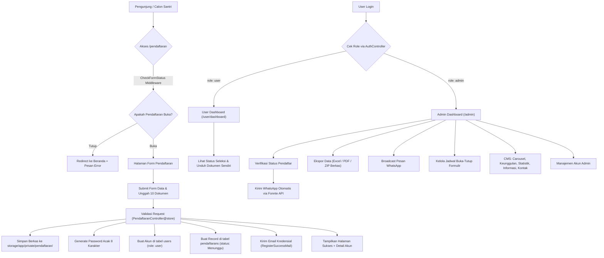

# SISTEM INFORMASI PENERIMAAN SANTRI BARU (PPDB) ONLINE
## PPTQ MUHAMMADIYAH IBNU JURAIMI / PPTQ SAHABATQU
### Dokumen Dokumentasi Teknis Lengkap & Spesifikasi Sistem

---

## DAFTAR ISI
1. [Tentang Proyek](#1-tentang-proyek)
2. [Tech Stack & Dependensi](#2-tech-stack--dependensi)
3. [Arsitektur Sistem & Struktur Direktori](#3-arsitektur-sistem--struktur-direktori)
4. [Arsitektur Database & Data Dictionary](#4-arsitektur-database--data-dictionary)
5. [Katalog Query Database (Eloquent & Raw SQL)](#5-katalog-query-database-eloquent--raw-sql)
6. [Autentikasi, Otorisasi, & Hak Akses (RBAC)](#6-autentikasi-otorisasi--hak-akses-rbac)
7. [Katalog Lengkap Route & Endpoint](#7-katalog-lengkap-route--endpoint)
8. [Integrasi Eksternal & Third-Party API](#8-integrasi-eksternal--third-party-api)
9. [Manajemen File & Penyimpanan Dokumen](#9-manajemen-file--penyimpanan-dokumen)
10. [Konfigurasi Environment (.env)](#10-konfigurasi-environment-env)
11. [Panduan Instalasi & Deployment](#11-panduan-instalasi--deployment)

---

## 1. TENTANG PROYEK

Aplikasi Web **Penerimaan Peserta Didik Baru (PPDB) PPTQ Muhammadiyah Ibnu Juraimi** (dikenal juga dalam proyek capstone sebagai PPTQ SahabatQu) adalah sistem berbasis framework Laravel yang dirancang untuk mentransformasi proses seleksi santri dari metode manual (Google Form) menjadi platform digital terintegrasi penuh.

### 1.1 Masalah yang Diselesaikan
* **Pencatatan Tercecer:** Dokumen calon santri sebelumnya tersimpan terpisah di Google Drive atau spreadsheet manual.
* **Kurangnya Transparansi:** Calon santri dan wali santri kesulitan memantau progres verifikasi berkas secara mandiri.
* **Komunikasi Manual:** Panitia harus mengirimkan notifikasi satu per satu melalui kontak manual.
* **Risiko Duplikasi Akun:** Tidak adanya sistem pembuatan akun otomatis saat pendaftaran formulir.

### 1.2 Solusi & Fitur Kunci
* **Akun Otomatis Santri:** Setiap santri yang mengisi form pendaftaran otomatis dibuatkan akun pengguna (`role: user`) dengan password acak 8 karakter yang dikirimkan via email serta ditampilkan pada halaman konfirmasi.
* **Multi-Upload Berkas:** Mengakomodasi 10 jenis dokumen berkas calon santri (Pas Photo, Bukti Transfer, Formulir, Surat Pernyataan, Akta, KK, Rapor, Ijazah, SKHUN, SKTM).
* **Download Berkas Tunggal & ZIP Batch:** Admin dapat mengunduh berkas satu per satu atau langsung mengepak seluruh dokumen santri ke dalam 1 file `.zip`.
* **Notifikasi WhatsApp Otomatis (Fonnte API):** Notifikasi terkirim langsung ke nomor WhatsApp santri saat status verifikasi diperbarui, serta fasilitas pesan siaran (broadcast) massal ke seluruh santri berdasarkan status seleksi.
* **Kontrol Jadwal Pendaftaran Otomatis:** Formulir otomatis buka dan tutup sesuai batas tanggal (`tanggal_buka` dan `tanggal_tutup`) menggunakan middleware proteksi.
* **CMS Halaman Depan:** Admin dapat mengelola Banner Carousel, Keunggulan Pondok, Angka Statistik (Santri Aktif, Asatidzah Bersanad, Tahun Berkhidmat), Informasi Pengumuman, dan Kontak.
* **Export Data:** Rekapitulasi pendaftar dapat diunduh dalam format Microsoft Excel (`.xlsx`) dan Adobe PDF landscape (`.pdf`).

---

## 2. TECH STACK & DEPENDENSI

### 2.1 Backend Core
| Komponen | Teknologi | Versi | Peran / Keterangan |
| :--- | :--- | :--- | :--- |
| **Bahasa Pemrograman** | PHP | `^8.2` | Runtime engine backend utama |
| **Framework Backend** | Laravel Framework | `12.35.1` (`^12.0`) | Framework MVC modern dengan Eloquent ORM, Route, Blade, dsb. |
| **Starter Kit Auth** | Laravel Breeze | `^2.3` | Scaffolding autentikasi berbasis Blade & Session |
| **Interactive Shell** | Laravel Tinker | `^2.10.1` | CLI REPL untuk manipulasi model dan data Eloquent |
| **Development Engine** | Laravel Sail | `^1.41` | Docker environment resmi untuk pengembangan Laravel |
| **Log Tail Viewer** | Laravel Pail | `^1.2.2` | Real-time log monitoring di terminal |
| **Code Style Fixer** | Laravel Pint | `^1.24` | Formatter kode PHP berbasis PSR-12 |

### 2.2 Database & Data Store
| Komponen | Teknologi | Peran / Keterangan |
| :--- | :--- | :--- |
| **Database Engine Utama** | MySQL (MariaDB compatible) | Menyimpan data tabel transaksional, pendaftaran, akun, dan konten CMS |
| **Database Alternatif / Testing** | SQLite | Didukung secara native untuk unit testing atau demo standalone |
| **Session & Cache Driver** | Database (`sessions`, `cache`) | Session pengguna dan caching disimpan di database |
| **Queue Connection** | Database (`jobs`, `failed_jobs`) | Antrean background job untuk pengiriman email dan proses berat |

### 2.3 Frontend & Tampilan UI
| Komponen | Teknologi / Library | Versi / Sumber | Peran / Keterangan |
| :--- | :--- | :--- | :--- |
| **Template Engine** | Laravel Blade | Native | Templating view server-side rendering dengan layouting modular |
| **CSS Framework 1** | Tailwind CSS | `^3.1.0` / `@tailwindcss/vite ^4.0.0` | Styling utilitas modern untuk komponen autentikasi dan form |
| **CSS Framework 2** | Bootstrap | `5.3.2` (CDN) | Grid system, modal, navbar, dan layout dashboard admin/user |
| **JavaScript Framework** | Alpine.js | `^3.4.2` | Reaktivitas antarmuka ringan untuk interaksi komponen dropdown/modal |
| **HTTP Client Frontend** | Axios | `^1.11.0` | Library HTTP request berbasis Promise |
| **Grafik & Visualisasi** | Chart.js | CDN | Visualisasi grafik donat (*Doughnut Chart*) sebaran pendaftar laki-laki vs perempuan |
| **Animasi Tampilan** | AOS (Animate On Scroll) | `2.3.1` (CDN) | Efek transisi halus dan animasi fade saat scroll halaman landing |
| **Icon Pack** | FontAwesome 6 | `6.5.0` (CDN) | Kumpulan ikon antarmuka navigasi, tombol, dan status |
| **Tipografi** | Google Fonts | Plus Jakarta Sans | Font modern untuk seluruh antarmuka web |

### 2.4 Asset Pipeline & Build Tools
| Komponen | Versi | Peran |
| :--- | :--- | :--- |
| **Bundler / Build Tool** | Vite `^7.0.7` | Modul bundler ultra-cepat untuk kompilasi CSS & JS |
| **Vite Plugin** | `laravel-vite-plugin ^2.0.0` | Integrasi Hot Module Replacement (HMR) Blade-Vite |
| **CSS Post-processor** | PostCSS `^8.4.31`, Autoprefixer `^10.4.2` | Standarisasi prefix vendor CSS |
| **Process Runner** | Concurrently `^9.0.1` | Menjalankan server artisan, queue, pail, dan vite dev secara paralel |

### 2.5 Ekspor Dokumen & Manipulasi File
| Library / Modul | Versi | Peran / Keterangan |
| :--- | :--- | :--- |
| **`maatwebsite/excel`** | `4.x-dev` | Ekspor rekapitulasi data pendaftar ke spreadsheet Excel (`.xlsx`) |
| **`barryvdh/laravel-dompdf`** | `^3.1` | Konversi view Blade ke dokumen PDF A4 Landscape (`.pdf`) |
| **PHP `ZipArchive`** | Ekstensi PHP Native | Mengompresi seluruh file berkas pendaftar menjadi 1 file arsip `.zip` |
| **Laravel Storage** | Local Disk (`storage/app/private`) | Penyimpanan terproteksi untuk dokumen sensitif santri |
| **Laravel Public Disk** | Public Disk (`storage/app/public`) | Penyimpanan publik gambar carousel dan file arsip unduhan sementara |

### 2.6 Integrasi Eksternal & Notifikasi
| Layanan / API | Driver / Provider | Peran / Keterangan |
| :--- | :--- | :--- |
| **WhatsApp Gateway** | Fonnte API (`https://api.fonnte.com/send`) | Pengiriman pesan status pendaftaran & broadcast pengumuman via WhatsApp |
| **Email Transaksional** | Laravel Mail (SMTP / Log) | Mengirim kredensial login (Email & Password acak) ke santri baru |

### 2.7 Testing & QA
* **PHPUnit** `^11.5.3`: Framework pengujian unit dan fungsional fitur.
* **FakerPHP** `^1.23`: Generator data dummy saat seeding atau testing.
* **Mockery** `^1.6`: Mocking objek untuk pengujian isolasi.

---

## 3. ARSITEKTUR SISTEM & STRUKTUR DIREKTORI

Sistem dibangun dengan arsitektur **Model-View-Controller (MVC)** standar Laravel 12 yang diperkuat dengan lapisan *Middleware* kustom dan pemisahan storage publik vs privat.

### 3.1 Diagram Alur Aplikasi (Flowchart)



### 3.2 Pohon Struktur Direktori Proyek

```text
pendaftaran-pptq/
├── app/
│   ├── Exports/
│   │   └── PendaftarExport.php           # Konfigurasi ekspor Excel (Maatwebsite)
│   ├── Http/
│   │   ├── Controllers/
│   │   │   ├── Admin/
│   │   │   │   ├── CarouselController.php     # CRUD Banner Carousel
│   │   │   │   ├── KeunggulanController.php   # CRUD Keunggulan Pesantren
│   │   │   │   └── StatistikController.php    # Edit angka statistik landing
│   │   │   ├── Auth/                          # Controller bawaan Laravel Breeze
│   │   │   ├── AdminController.php            # Pusat administrasi pendaftar, export, Fonnte, akun admin
│   │   │   ├── AdminInformasiController.php   # CRUD berita / pengumuman
│   │   │   ├── AdminKontakController.php      # Pengaturan info kontak lembaga
│   │   │   ├── AuthController.php             # Login manual multi-role & logout
│   │   │   ├── DashboardController.php        # Dispatcher dashboard sesuai role
│   │   │   ├── PendaftaranController.php      # Halaman publik & proses registrasi santri
│   │   │   ├── ProfileController.php          # Edit profil user
│   │   │   └── UserController.php             # Dashboard santri & unduh file sendiri
│   │   ├── Middleware/
│   │   │   ├── CheckFormStatus.php       # Verifikasi rentang tanggal jadwal pendaftaran
│   │   │   └── RoleMiddleware.php         # Otorisasi role 'admin' atau 'user'
│   │   └── Requests/                     # Form request validation
│   ├── Mail/
│   │   └── RegisterSuccessMail.php       # Mailable notifikasi pendaftaran & kredensial
│   ├── Models/
│   │   ├── Carousel.php                  # Model tabel carousels
│   │   ├── Informasi.php                 # Model tabel informasis
│   │   ├── Keunggulan.php                # Model tabel keunggulans
│   │   ├── Kontak.php                    # Model tabel kontaks
│   │   ├── Pendaftaran.php               # Model data santri & 10 field berkas
│   │   ├── Statistik.php                 # Model angka capaian pondok
│   │   ├── StatusForm.php                # Model status & tanggal buka-tutup form
│   │   └── User.php                      # Model user & relasi hasOne pendaftaran
│   └── Providers/
│       └── AppServiceProvider.php        # Booting service provider
├── bootstrap/
│   └── app.php                           # Registrasi middleware alias & routing Laravel 12
├── config/                               # Berkas konfigurasi framework & database
├── database/
│   ├── factories/
│   │   └── UserFactory.php               # Factory dummy user
│   ├── migrations/                       # Berkas migrasi skema tabel database
│   └── seeders/
│       ├── DatabaseSeeder.php            # Seeder akun admin utama
│       └── StatistikSeeder.php           # Seeder angka statistik awal
├── public/                               # Entry point publik web (index.php, symlink storage)
├── resources/
│   ├── css/                              # File Tailwind CSS (app.css)
│   ├── js/                               # File JavaScript (app.js, bootstrap.js, Alpine)
│   └── views/
│       ├── admin/                        # View antarmuka administrator
│       ├── auth/                         # View login, registrasi, lupa password
│       ├── emails/                       # View template email pendaftaran berhasil
│       ├── layouts/                      # Layout induk (app.blade.php, guest.blade.php)
│       ├── public/                       # View beranda, form pendaftaran, informasi, kontak
│       └── user/                         # View dashboard calon santri
├── routes/
│   ├── auth.php                          # Rute autentikasi Breeze
│   ├── console.php                       # Artisan command route
│   └── web.php                           # Definisi seluruh endpoint web aplikasi
├── storage/
│   ├── app/
│   │   ├── private/                      # Berkas dokumen pendaftar yang diamankan
│   │   └── public/                       # Berkas gambar carousel publik
│   └── logs/                             # Catatan log aplikasi
├── composer.json                         # Dependensi PHP & Composer scripts
├── package.json                          # Dependensi NPM & Vite scripts
├── tailwind.config.js                    # Konfigurasi Tailwind CSS
└── vite.config.js                        # Konfigurasi bundler Vite
```

---

## 4. ARSITEKTUR DATABASE & DATA DICTIONARY

Sistem menggunakan database relasional dengan tabel inti pendaftaran yang berelasi 1:1 ke tabel pengguna (*users*), serta tabel-tabel pendukung untuk kontrol sistem dan konten dinamis.

### 4.1 Entity Relationship Diagram (ERD)

```mermaid
erDiagram
    USERS ||--o| PENDAFTARANS : "has one (user_id)"
    
    USERS {
        bigint id PK
        string name
        string email UK
        timestamp email_verified_at
        string password
        string role "admin | user"
        string status "active | nullable"
        string remember_token
        timestamp created_at
        timestamp updated_at
    }

    PENDAFTARANS {
        bigint id PK
        bigint user_id FK
        string nama_lengkap
        enum jenis_kelamin "Laki-laki | Perempuan"
        string email
        string no_hp
        text alamat
        string tempat_lahir
        date tanggal_lahir
        string nisn "10 digit"
        string nik_santri "16 digit"
        string no_kk "16 digit"
        string nama_ayah
        string nik_ayah "16 digit"
        string pekerjaan_ayah
        string penghasilan_ayah
        string no_hp_ayah
        string nama_ibu
        string nik_ibu "16 digit"
        string pekerjaan_ibu
        string penghasilan_ibu
        string no_hp_ibu
        string asal_sekolah
        string alamat_asal_sekolah
        string jumlah_hafalan
        string prestasi
        string pas_photo "Path file"
        string bukti_transfer "Path file"
        string formulir_pendaftaran "Path file"
        string surat_pernyataan "Path file"
        string akta_kelahiran "Path file"
        string kartu_keluarga "Path file"
        string ijazah_terakhir "Path file (opsional)"
        string raport_terakhir "Path file"
        string skhun "Path file (opsional)"
        string sktm "Path file (opsional)"
        string berkas "Legacy (deprecated)"
        enum status "Menunggu | Lulus | Tidak Lulus"
        timestamp tanggal_daftar
        timestamp created_at
        timestamp updated_at
    }

    STATUS_FORMS {
        bigint id PK
        enum status "Buka | Tutup"
        date tanggal_buka
        date tanggal_tutup
        timestamp created_at
        timestamp updated_at
    }

    INFORMAZIS {
        bigint id PK
        string judul
        text isi
        timestamp created_at
        timestamp updated_at
    }

    KONTAKS {
        bigint id PK
        string alamat
        string telepon
        string email
        timestamp created_at
        timestamp updated_at
    }

    STATISTIKS {
        bigint id PK
        int santri_aktif
        int asatidzah_bersanad
        int tahun_berkhidmat
    }

    CAROUSELS {
        bigint id PK
        string image "Path file"
        string caption
        int order
    }

    KEUNGGULANS {
        bigint id PK
        string judul
        string deskripsi_singkat
        text deskripsi_detail
        int order
    }
```



---

### 4.2 Data Dictionary (Kamus Data Tabel)

#### A. Tabel `users`
Menyimpan identitas akun, kredensial terenkripsi, dan hak akses.
| Kolom | Tipe Data | Nullable | Default | Keterangan |
| :--- | :--- | :--- | :--- | :--- |
| `id` | `BIGINT UNSIGNED` | No | Auto Increment | Primary Key |
| `name` | `VARCHAR(255)` | No | - | Nama lengkap pengguna |
| `email` | `VARCHAR(255)` | No | - | Email login (Unique) |
| `email_verified_at` | `TIMESTAMP` | Yes | `NULL` | Waktu verifikasi email |
| `password` | `VARCHAR(255)` | No | - | Password hash (Bcrypt / Argon2) |
| `role` | `VARCHAR(255)` | No | `'user'` | Level hak akses: `'admin'` atau `'user'` |
| `status` | `VARCHAR(255)` | Yes | `NULL` | Status keaktifan akun (misal: `'active'`) |
| `remember_token` | `VARCHAR(100)` | Yes | `NULL` | Token "Remember Me" |
| `created_at` | `TIMESTAMP` | Yes | `NULL` | Waktu pembuatan akun |
| `updated_at` | `TIMESTAMP` | Yes | `NULL` | Waktu modifikasi data akun |

#### B. Tabel `pendaftarans`
Menyimpan seluruh data biodata santri, orang tua, sekolah asal, berkas unggahan, serta status verifikasi.
| Kolom | Tipe Data | Nullable | Default | Keterangan |
| :--- | :--- | :--- | :--- | :--- |
| `id` | `BIGINT UNSIGNED` | No | Auto Increment | Primary Key |
| `user_id` | `BIGINT UNSIGNED` | No | - | Foreign Key mengarah ke `users.id` (On Delete Cascade) |
| `nama_lengkap` | `VARCHAR(255)` | No | - | Nama santri |
| `jenis_kelamin` | `ENUM('Laki-laki', 'Perempuan')` | No | - | Jenis kelamin pendaftar |
| `email` | `VARCHAR(255)` | No | - | Email kontak santri |
| `no_hp` | `VARCHAR(20)` | No | - | Nomor WhatsApp santri (sasaran notifikasi Fonnte) |
| `alamat` | `TEXT` | No | - | Alamat domisili |
| `tempat_lahir` | `VARCHAR(100)` | Yes | `NULL` | Tempat lahir santri |
| `tanggal_lahir` | `DATE` | Yes | `NULL` | Tanggal lahir santri |
| `nisn` | `VARCHAR(10)` | Yes | `NULL` | Nomor Induk Siswa Nasional (10 digit) |
| `nik_santri` | `VARCHAR(255)` | Yes | `NULL` | Nomor Induk Kependudukan Santri (16 digit) |
| `no_kk` | `VARCHAR(255)` | Yes | `NULL` | Nomor Kartu Keluarga (16 digit) |
| `nama_ayah` | `VARCHAR(255)` | Yes | `NULL` | Nama ayah kandung / wali |
| `nik_ayah` | `VARCHAR(255)` | Yes | `NULL` | NIK ayah (16 digit) |
| `pekerjaan_ayah` | `VARCHAR(100)` | Yes | `NULL` | Pekerjaan ayah |
| `penghasilan_ayah`| `VARCHAR(255)` | Yes | `NULL` | Range penghasilan ayah per bulan |
| `no_hp_ayah` | `VARCHAR(255)` | Yes | `NULL` | Nomor telepon / HP ayah |
| `nama_ibu` | `VARCHAR(255)` | Yes | `NULL` | Nama ibu kandung |
| `nik_ibu` | `VARCHAR(255)` | Yes | `NULL` | NIK ibu (16 digit) |
| `pekerjaan_ibu` | `VARCHAR(100)` | Yes | `NULL` | Pekerjaan ibu |
| `penghasilan_ibu` | `VARCHAR(255)` | Yes | `NULL` | Range penghasilan ibu per bulan |
| `no_hp_ibu` | `VARCHAR(255)` | Yes | `NULL` | Nomor telepon / HP ibu |
| `asal_sekolah` | `VARCHAR(255)` | Yes | `NULL` | Nama sekolah sebelumnya (SD/MI/SMP/MTs) |
| `alamat_asal_sekolah` | `VARCHAR(255)` | Yes | `NULL` | Alamat sekolah asal |
| `jumlah_hafalan` | `VARCHAR(100)` | Yes | `NULL` | Riwayat hafalan Al-Qur'an (misal: "2 Juz") |
| `prestasi` | `VARCHAR(255)` | Yes | `NULL` | Prestasi akademik/non-akademik |
| `pas_photo` | `VARCHAR(255)` | Yes | `NULL` | Path file pasfoto 3x4 |
| `bukti_transfer` | `VARCHAR(255)` | Yes | `NULL` | Path bukti transfer biaya pendaftaran |
| `formulir_pendaftaran` | `VARCHAR(255)` | Yes | `NULL` | Path file formulir fisik bertanda tangan |
| `surat_pernyataan` | `VARCHAR(255)` | Yes | `NULL` | Path scan surat pernyataan kesediaan |
| `akta_kelahiran` | `VARCHAR(255)` | Yes | `NULL` | Path scan Akta Kelahiran |
| `kartu_keluarga` | `VARCHAR(255)` | Yes | `NULL` | Path scan Kartu Keluarga |
| `ijazah_terakhir`| `VARCHAR(255)` | Yes | `NULL` | Path scan Ijazah terakhir (opsional) |
| `raport_terakhir`| `VARCHAR(255)` | Yes | `NULL` | Path scan Rapor terakhir |
| `skhun` | `VARCHAR(255)` | Yes | `NULL` | Path scan SKHUN (opsional) |
| `sktm` | `VARCHAR(255)` | Yes | `NULL` | Path Surat Keterangan Tidak Mampu (opsional) |
| `berkas` | `VARCHAR(255)` | Yes | `NULL` | Kolom berkas lama (deprecated) |
| `status` | `ENUM('Menunggu', 'Lulus', 'Tidak Lulus')` | No | `'Menunggu'` | Status verifikasi panitia |
| `tanggal_daftar` | `TIMESTAMP` | No | `CURRENT_TIMESTAMP` | Tanggal dan waktu registrasi |
| `created_at` | `TIMESTAMP` | Yes | `NULL` | Waktu record dibuat |
| `updated_at` | `TIMESTAMP` | Yes | `NULL` | Waktu record diubah |

#### C. Tabel `status_forms`
Menyimpan status global pembukaan form dan konfigurasi rentang tanggal otomatis.
| Kolom | Tipe Data | Nullable | Default | Keterangan |
| :--- | :--- | :--- | :--- | :--- |
| `id` | `BIGINT UNSIGNED` | No | Auto Increment | Primary Key |
| `status` | `ENUM('Buka', 'Tutup')` | No | `'Buka'` | Status manual / otomatis |
| `tanggal_buka` | `DATE` | Yes | `NULL` | Tanggal awal pendaftaran dibuka |
| `tanggal_tutup` | `DATE` | Yes | `NULL` | Tanggal akhir pendaftaran ditutup |
| `created_at` | `TIMESTAMP` | Yes | `NULL` | Waktu konfigurasi dibuat |
| `updated_at` | `TIMESTAMP` | Yes | `NULL` | Waktu konfigurasi diubah |

#### D. Tabel `informasis`
Konten artikel pengumuman atau informasi seputar seleksi.
| Kolom | Tipe Data | Nullable | Default | Keterangan |
| :--- | :--- | :--- | :--- | :--- |
| `id` | `BIGINT UNSIGNED` | No | Auto Increment | Primary Key |
| `judul` | `VARCHAR(255)` | No | - | Judul informasi / pengumuman |
| `isi` | `TEXT` | No | - | Konten lengkap pengumuman |
| `created_at` | `TIMESTAMP` | Yes | `NULL` | Waktu dibuat |
| `updated_at` | `TIMESTAMP` | Yes | `NULL` | Waktu diperbarui |

#### E. Tabel `kontaks`
Informasi kontak dan alamat resmi lembaga PPTQ.
| Kolom | Tipe Data | Nullable | Default | Keterangan |
| :--- | :--- | :--- | :--- | :--- |
| `id` | `BIGINT UNSIGNED` | No | Auto Increment | Primary Key |
| `alamat` | `VARCHAR(255)` | No | - | Alamat fisik pesantren |
| `telepon` | `VARCHAR(20)` | No | - | Nomor kontak resmi |
| `email` | `VARCHAR(255)` | No | - | Email resmi lembaga |
| `created_at` | `TIMESTAMP` | Yes | `NULL` | Waktu dibuat |
| `updated_at` | `TIMESTAMP` | Yes | `NULL` | Waktu diperbarui |

#### F. Tabel `statistiks`
Menyimpan angka rekam jejak institusi untuk ditampilkan pada counter beranda.
| Kolom | Tipe Data | Nullable | Default | Keterangan |
| :--- | :--- | :--- | :--- | :--- |
| `id` | `BIGINT UNSIGNED` | No | Auto Increment | Primary Key |
| `santri_aktif` | `INT` | No | `0` | Jumlah santri aktif (default: 110) |
| `asatidzah_bersanad`| `INT` | No | `0` | Jumlah pengajar bersanad (default: 30) |
| `tahun_berkhidmat`| `INT` | No | `0` | Usia tahun kiprah lembaga (default: 13) |

#### G. Tabel `carousels`
Daftar gambar banner slider di beranda.
| Kolom | Tipe Data | Nullable | Default | Keterangan |
| :--- | :--- | :--- | :--- | :--- |
| `id` | `BIGINT UNSIGNED` | No | Auto Increment | Primary Key |
| `image` | `VARCHAR(255)` | No | - | Path file gambar (`carousel/...`) |
| `caption` | `VARCHAR(255)` | Yes | `NULL` | Keterangan / judul banner |
| `order` | `INT` | No | `0` | Urutan penayangan gambar |

#### H. Tabel `keunggulans`
Kartu poin-poin keunggulan program pendidikan pesantren.
| Kolom | Tipe Data | Nullable | Default | Keterangan |
| :--- | :--- | :--- | :--- | :--- |
| `id` | `BIGINT UNSIGNED` | No | Auto Increment | Primary Key |
| `judul` | `VARCHAR(255)` | No | - | Judul keunggulan |
| `deskripsi_singkat` | `VARCHAR(255)` | No | - | Ringkasan singkat pada card |
| `deskripsi_detail` | `TEXT` | No | - | Uraian lengkap keunggulan |
| `order` | `INT` | No | `0` | Urutan tampilan |

#### I. Tabel Pendukung Framework Laravel
1. `sessions`: Menyimpan session pengguna (`id`, `user_id`, `ip_address`, `user_agent`, `payload`, `last_activity`).
2. `password_reset_tokens`: Token reset sandi (`email`, `token`, `created_at`).
3. `cache` & `cache_locks`: Penyimpanan cache database framework.
4. `jobs`, `job_batches`, `failed_jobs`: Penanganan antrean asynchronous.

---

### 4.3 Database Seeders
* **`DatabaseSeeder`**:
  * Menggunakan `User::updateOrCreate(['role' => 'admin'], ...)` untuk mendaftarkan akun administrator default secara idempotensial:
    * Nama: `Administrator Utama`
    * Email dan password: diambil dari `ADMIN_EMAIL` dan `ADMIN_PASSWORD` di `.env` (tidak disimpan di repository)
    * Status: `active`
  * Menjalankan pemanggilan ke `StatistikSeeder`.
* **`StatistikSeeder`**:
  * Mengisi nilai default tabel `statistiks`:
    * `santri_aktif` = `110`
    * `asatidzah_bersanad` = `30`
    * `tahun_berkhidmat` = `13`

---

## 5. KATALOG QUERY DATABASE (ELOQUENT & RAW SQL)

Bagian ini mendokumentasikan setiap operasi query database yang dijalankan di seluruh controller aplikasi, lengkap dengan padanan Raw SQL-nya.

### 5.1 Query Modul Halaman Publik (`PendaftaranController`)

#### 1. Menampilkan Beranda Publik (`home`)
* **Kode Eloquent:**
  ```php
  $statistik = \App\Models\Statistik::first();
  $carousels = \App\Models\Carousel::orderBy('order')->get();
  $keunggulans = \App\Models\Keunggulan::orderBy('order')->get();
  ```
* **Raw SQL Equivalent:**
  ```sql
  SELECT * FROM statistiks LIMIT 1;
  SELECT * FROM carousels ORDER BY `order` ASC;
  SELECT * FROM keunggulans ORDER BY `order` ASC;
  ```

#### 2. Menampilkan Informasi / Pengumuman (`informasi`)
* **Kode Eloquent:**
  ```php
  $informasi = Informasi::latest()->get();
  ```
* **Raw SQL Equivalent:**
  ```sql
  SELECT * FROM informasis ORDER BY created_at DESC;
  ```

#### 3. Menampilkan Halaman Kontak (`contact`)
* **Kode Eloquent:**
  ```php
  $kontak = Kontak::first();
  ```
* **Raw SQL Equivalent:**
  ```sql
  SELECT * FROM kontaks LIMIT 1;
  ```

#### 4. Validasi Status Form Pendaftaran (`create`)
* **Kode Eloquent:**
  ```php
  $status = StatusForm::latest()->first();
  ```
* **Raw SQL Equivalent:**
  ```sql
  SELECT * FROM status_forms ORDER BY created_at DESC LIMIT 1;
  ```

#### 5. Registrasi Akun Santri & Data Pendaftaran (`store`)
* **Pengecekan Keunikan Email & Simpan User:**
  ```php
  $user = User::create([
      'name' => $request->nama_lengkap,
      'email' => $request->email,
      'password' => Hash::make($plainPassword),
      'role' => 'user',
      'status' => 'aktif',
  ]);
  ```
  *Raw SQL:*
  ```sql
  INSERT INTO users (name, email, password, role, status, created_at, updated_at) 
  VALUES ('Fulan', 'fulan@example.com', '$2y$12$...', 'user', 'aktif', NOW(), NOW());
  ```
* **Simpan Biodata Pendaftaran Santri:**
  ```php
  Pendaftaran::create([
      'user_id' => $user->id,
      'nama_lengkap' => $request->nama_lengkap,
      'jenis_kelamin' => $request->jenis_kelamin,
      'email' => $request->email,
      'no_hp' => $request->no_hp,
      'alamat' => $request->alamat,
      'tempat_lahir' => $request->tempat_lahir,
      'tanggal_lahir' => $request->tanggal_lahir,
      'nisn' => $request->nisn,
      'nik_santri' => $request->nik_santri,
      'pas_photo' => $filePaths['pas_photo'],
      'no_kk' => $request->no_kk,
      'nama_ayah' => $request->nama_ayah,
      'nik_ayah' => $request->nik_ayah,
      'pekerjaan_ayah' => $request->pekerjaan_ayah,
      'penghasilan_ayah' => $request->penghasilan_ayah,
      'nama_ibu' => $request->nama_ibu,
      'nik_ibu' => $request->nik_ibu,
      'pekerjaan_ibu' => $request->pekerjaan_ibu,
      'penghasilan_ibu' => $request->penghasilan_ibu,
      'no_hp_ayah' => $request->no_hp_ayah,
      'no_hp_ibu' => $request->no_hp_ibu,
      'asal_sekolah' => $request->asal_sekolah,
      'alamat_asal_sekolah' => $request->alamat_asal_sekolah,
      'jumlah_hafalan' => $request->jumlah_hafalan,
      'prestasi' => $request->prestasi,
      'bukti_transfer' => $filePaths['bukti_transfer'],
      'formulir_pendaftaran' => $filePaths['formulir_pendaftaran'],
      'surat_pernyataan' => $filePaths['surat_pernyataan'],
      'akta_kelahiran' => $filePaths['akta_kelahiran'],
      'kartu_keluarga' => $filePaths['kartu_keluarga'],
      'ijazah_terakhir' => $filePaths['ijazah_terakhir'],
      'raport_terakhir' => $filePaths['raport_terakhir'],
      'skhun' => $filePaths['skhun'],
      'sktm' => $filePaths['sktm'],
      'berkas' => null,
      'status' => 'Menunggu',
  ]);
  ```
  *Raw SQL:*
  ```sql
  INSERT INTO pendaftarans (
      user_id, nama_lengkap, jenis_kelamin, email, no_hp, alamat,
      tempat_lahir, tanggal_lahir, nisn, nik_santri, no_kk,
      nama_ayah, nik_ayah, pekerjaan_ayah, penghasilan_ayah, no_hp_ayah,
      nama_ibu, nik_ibu, pekerjaan_ibu, penghasilan_ibu, no_hp_ibu,
      asal_sekolah, alamat_asal_sekolah, jumlah_hafalan, prestasi,
      pas_photo, bukti_transfer, formulir_pendaftaran, surat_pernyataan,
      akta_kelahiran, kartu_keluarga, ijazah_terakhir, raport_terakhir, skhun, sktm,
      berkas, status, created_at, updated_at
  ) VALUES (
      12, 'Fulan', 'Laki-laki', 'fulan@example.com', '08123456789', 'Jl. Merdeka No 1',
      'Bantul', '2010-05-12', '1234567890', '3402010000000001', '3402010000000002',
      'Ahmad', '3402010000000003', 'PNS', 'Rp 5.000.000', '08111111111',
      'Siti', '3402010000000004', 'Guru', 'Rp 4.000.000', '08222222222',
      'SMP N 1', 'Jl. Pendidikan', '3 Juz', 'Juara 1 MTQ',
      'pendaftaran/pas_photo/...', 'pendaftaran/bukti_transfer/...', '...', '...',
      '...', '...', '...', '...', '...', '...',
      NULL, 'Menunggu', NOW(), NOW()
  );
  ```

---

### 5.2 Query Modul Dashboard Santri (`UserController` & `DashboardController`)

#### 1. Mengambil Data Pendaftaran Milik Santri yang Sedang Login
* **Kode Eloquent:**
  ```php
  // Melalui Relasi Model User
  $pendaftaran = Auth::user()->pendaftaran;
  
  // Atau melalui pemanggilan langsung:
  $pendaftaran = Pendaftaran::where('user_id', $user->id)->first();
  ```
* **Raw SQL Equivalent:**
  ```sql
  SELECT * FROM pendaftarans WHERE user_id = ? LIMIT 1;
  ```

---

### 5.3 Query Modul Admin (`AdminController`)

#### 1. Filter Pencarian, Status, & Statistik Gender (`dashboard`)
* **Kode Eloquent:**
  ```php
  $query = Pendaftaran::query();

  // Pencarian teks
  if ($search) {
      $query->where(function($q) use ($search) {
          $q->where('nama_lengkap', 'like', "%$search%")
            ->orWhere('email', 'like', "%$search%")
            ->orWhere('no_hp', 'like', "%$search%");
      });
  }

  // Filter status seleksi
  if ($status) {
      $query->where('status', $status);
  }

  // Filter jenis kelamin
  if ($jenis_kelamin) {
      $query->where('jenis_kelamin', $jenis_kelamin);
  }

  // Menghitung sebaran gender berdasarkan filter yang aktif
  $lakiLaki = (clone $query)->where('jenis_kelamin', 'Laki-laki')->count();
  $perempuan = (clone $query)->where('jenis_kelamin', 'Perempuan')->count();

  // Pagination pendaftar terbaru
  $pendaftar = $query->latest()->paginate(10)->withQueryString();

  // Total pendaftar keseluruhan & yang menunggu verifikasi
  $total = Pendaftaran::count();
  $menunggu = Pendaftaran::where('status', 'Menunggu')->count();
  ```
* **Raw SQL Equivalent:**
  ```sql
  -- Menghitung total pendaftar
  SELECT COUNT(*) FROM pendaftarans;
  
  -- Menghitung status menunggu
  SELECT COUNT(*) FROM pendaftarans WHERE status = 'Menunggu';

  -- Menghitung sebaran santri laki-laki (mengikuti filter pencarian jika ada)
  SELECT COUNT(*) FROM pendaftarans 
  WHERE (nama_lengkap LIKE '%keyword%' OR email LIKE '%keyword%' OR no_hp LIKE '%keyword%')
    AND status = 'Menunggu'
    AND jenis_kelamin = 'Laki-laki';

  -- Mengambil daftar santri terpaginasi (Halaman 1, limit 10)
  SELECT * FROM pendaftarans 
  WHERE (nama_lengkap LIKE '%keyword%' OR email LIKE '%keyword%' OR no_hp LIKE '%keyword%')
    AND status = 'Menunggu'
    AND jenis_kelamin = 'Laki-laki'
  ORDER BY created_at DESC 
  LIMIT 10 OFFSET 0;
  ```

#### 2. Mengambil Detail Santri (`show` & `downloadZip`)
* **Kode Eloquent:**
  ```php
  $pendaftar = Pendaftaran::findOrFail($id);
  ```
* **Raw SQL Equivalent:**
  ```sql
  SELECT * FROM pendaftarans WHERE id = ? LIMIT 1;
  ```

#### 3. Verifikasi Status Pendaftar (`verifikasi`)
* **Kode Eloquent:**
  ```php
  $pendaftaran = Pendaftaran::findOrFail($id);
  $pendaftaran->status = $request->status;
  $pendaftaran->save();
  ```
* **Raw SQL Equivalent:**
  ```sql
  UPDATE pendaftarans SET status = ?, updated_at = NOW() WHERE id = ?;
  ```

#### 4. Menghapus 1 Santri & Akun Terkait (`destroy`)
* **Kode Eloquent:**
  ```php
  $pendaftar = Pendaftaran::findOrFail($id);
  if ($pendaftar->user) {
      $pendaftar->user->delete();
  }
  $pendaftar->delete();
  ```
* **Raw SQL Equivalent:**
  ```sql
  DELETE FROM users WHERE id = (SELECT user_id FROM pendaftarans WHERE id = ?);
  DELETE FROM pendaftarans WHERE id = ?;
  ```

#### 5. Menghapus Seluruh Pendaftar Sekaligus Dalam Database Transaction (`destroyAll`)
* **Kode Eloquent:**
  ```php
  DB::transaction(function () {
      $pendaftar = Pendaftaran::all();
      foreach ($pendaftar as $p) {
          if ($p->user) {
              $p->user->delete();
          }
          $p->delete();
      }
  });
  ```
* **Raw SQL Equivalent:**
  ```sql
  START TRANSACTION;
  -- Dijalankan iterasi untuk setiap entri dan menghapus relasi user & pendaftaran
  DELETE FROM users WHERE id IN (...);
  DELETE FROM pendaftarans;
  COMMIT;
  ```

#### 6. Mengambil Data untuk Ekspor Excel (`PendaftarExport`)
* **Kode Eloquent:**
  ```php
  Pendaftaran::select(
      'nama_lengkap', 'jenis_kelamin', 'email', 'no_hp', 'tempat_lahir',
      'tanggal_lahir', 'nik_santri', 'nisn', 'no_kk', 'alamat',
      'nama_ayah', 'nik_ayah', 'pekerjaan_ayah', 'penghasilan_ayah', 'no_hp_ayah',
      'nama_ibu', 'nik_ibu', 'pekerjaan_ibu', 'penghasilan_ibu', 'no_hp_ibu',
      'asal_sekolah', 'alamat_asal_sekolah', 'jumlah_hafalan', 'prestasi', 'status'
  )->get();
  ```
* **Raw SQL Equivalent:**
  ```sql
  SELECT 
      nama_lengkap, jenis_kelamin, email, no_hp, tempat_lahir,
      tanggal_lahir, nik_santri, nisn, no_kk, alamat,
      nama_ayah, nik_ayah, pekerjaan_ayah, penghasilan_ayah, no_hp_ayah,
      nama_ibu, nik_ibu, pekerjaan_ibu, penghasilan_ibu, no_hp_ibu,
      asal_sekolah, alamat_asal_sekolah, jumlah_hafalan, prestasi, status
  FROM pendaftarans;
  ```

#### 7. Mengambil Target Penerima Notifikasi WhatsApp (`kirimNotifikasi`)
* **Kode Eloquent:**
  ```php
  if ($request->status == 'semua') {
      $pendaftar = Pendaftaran::all();
  } else {
      $pendaftar = Pendaftaran::where('status', $request->status)->get();
  }
  ```
* **Raw SQL Equivalent:**
  ```sql
  -- Jika status = 'semua'
  SELECT * FROM pendaftarans;
  
  -- Jika difilter per status
  SELECT * FROM pendaftarans WHERE status = ?;
  ```

#### 8. Sinkronisasi Tanggal Buka/Tutup Form (`statusForm` & `updateStatusForm`)
* **Kode Eloquent:**
  ```php
  $statusForm = StatusForm::first();
  $statusForm->update([
      'tanggal_buka' => $request->tanggal_buka,
      'tanggal_tutup' => $request->tanggal_tutup,
      'status' => ($today >= $tanggal_buka && $today <= $tanggal_tutup) ? 'Buka' : 'Tutup'
  ]);
  ```
* **Raw SQL Equivalent:**
  ```sql
  UPDATE status_forms 
  SET tanggal_buka = ?, tanggal_tutup = ?, status = ?, updated_at = NOW() 
  WHERE id = 1;
  ```

#### 9. Pengelolaan Akun Admin (`adminIndex`, `adminStore`, `adminDestroy`, `resetPasswordUpdate`)
* **Daftar Akun Admin:**
  ```php
  User::where('role', 'admin')->paginate(10);
  ```
  *Raw SQL:* `SELECT * FROM users WHERE role = 'admin' LIMIT 10 OFFSET 0;`
* **Tambah Akun Admin:**
  ```php
  User::create([
      'name' => $request->name,
      'email' => $request->email,
      'password' => Hash::make($request->password),
      'role' => 'admin',
      'status' => 'active',
  ]);
  ```
  *Raw SQL:* `INSERT INTO users (name, email, password, role, status, created_at, updated_at) VALUES (?, ?, ?, 'admin', 'active', NOW(), NOW());`
* **Hapus Akun Admin (Proteksi diri sendiri):**
  ```php
  User::where('id', $id)->where('role', 'admin')->delete();
  ```
  *Raw SQL:* `DELETE FROM users WHERE id = ? AND role = 'admin';`
* **Reset Password Admin:**
  ```php
  $admin->update(['password' => Hash::make($request->password)]);
  ```
  *Raw SQL:* `UPDATE users SET password = ?, updated_at = NOW() WHERE id = ?;`

---

### 5.4 Query Modul CMS Konten (`Carousel`, `Keunggulan`, `Informasi`, `Kontak`)

* **Carousel Index:** `SELECT * FROM carousels ORDER BY `order` ASC;`
* **Carousel Create:** `INSERT INTO carousels (image, caption, `order`) VALUES (?, ?, ?);`
* **Carousel Update:** `UPDATE carousels SET caption = ?, `order` = ? WHERE id = ?;`
* **Carousel Delete:** `DELETE FROM carousels WHERE id = ?;`
* **Keunggulan Index:** `SELECT * FROM keunggulans ORDER BY `order` ASC;`
* **Keunggulan Create:** `INSERT INTO keunggulans (judul, deskripsi_singkat, deskripsi_detail, `order`) VALUES (?, ?, ?, ?);`
* **Keunggulan Delete:** `DELETE FROM keunggulans WHERE id = ?;`
* **Statistik Update:** `UPDATE statistiks SET santri_aktif = ?, asatidzah_bersanad = ?, tahun_berkhidmat = ? WHERE id = 1;`
* **Informasi Index:** `SELECT * FROM informasis ORDER BY created_at DESC;`
* **Informasi Create:** `INSERT INTO informasis (judul, isi, created_at, updated_at) VALUES (?, ?, NOW(), NOW());`
* **Informasi Delete:** `DELETE FROM informasis WHERE id = ?;`
* **Kontak Update:** `UPDATE kontaks SET alamat = ?, telepon = ?, email = ?, updated_at = NOW() WHERE id = 1;`

---

## 6. AUTENTIKASI, OTORISASI, & HAK AKSES (RBAC)

Aplikasi menerapkan sistem Role-Based Access Control (RBAC) dengan dua peran utama: `admin` dan `user`.

### 6.1 Matriks Hak Akses Pengguna

| Fitur / Modul | Pengunjung Umum (Guest) | Calon Santri (`role: user`) | Panitia Admin (`role: admin`) |
| :--- | :---: | :---: | :---: |
| Lihat Beranda, Informasi, Kontak | ✅ Ya | ✅ Ya | ✅ Ya |
| Akses Form Pendaftaran | ✅ Ya (Jika buka) | ⚠️ Terbatas | ⚠️ Terbatas |
| Lihat Halaman Sukses Registrasi | ❌ Tidak | ✅ Ya | ❌ Tidak |
| Login / Logout | ✅ Ya (Login) | ✅ Ya (Logout) | ✅ Ya (Logout) |
| Dashboard Calon Santri | ❌ Tidak | ✅ Ya | ❌ Tidak (Redirect) |
| Unduh Berkas Pribadi | ❌ Tidak | ✅ Ya (Berkas sendiri) | ❌ Tidak |
| Dashboard Administrator | ❌ Tidak | ❌ Ditolak (403) | ✅ Ya |
| Verifikasi Status Pendaftar | ❌ Tidak | ❌ Ditolak (403) | ✅ Ya |
| Kirim Pesan WhatsApp (Fonnte) | ❌ Tidak | ❌ Ditolak (403) | ✅ Ya |
| Ekspor Data (Excel, PDF, ZIP) | ❌ Tidak | ❌ Ditolak (403) | ✅ Ya |
| Hapus Data Santri (Single / All)| ❌ Tidak | ❌ Ditolak (403) | ✅ Ya |
| Buka / Tutup Jadwal Form | ❌ Tidak | ❌ Ditolak (403) | ✅ Ya |
| CMS Banner, Keunggulan, Statistik | ❌ Tidak | ❌ Ditolak (403) | ✅ Ya |
| CMS Informasi & Kontak | ❌ Tidak | ❌ Ditolak (403) | ✅ Ya |
| Manajemen Akun & Reset Admin | ❌ Tidak | ❌ Ditolak (403) | ✅ Ya |

---

### 6.2 Alur Pembuatan Akun Otomatis Santri
1. Calon santri mengisi form pada route `/pendaftaran`.
2. Sistem mengeksekusi validasi server-side (`PendaftaranController@store`).
3. Dihasilkan string acak sepanjang 8 karakter:
   ```php
   $plainPassword = \Illuminate\Support\Str::random(8);
   ```
4. User diinsert ke tabel `users` dengan `role = 'user'` dan `password = Hash::make($plainPassword)`.
5. Record pendaftaran diinsert dengan `user_id = $user->id`.
6. Password polos dikirimkan ke email pendaftar melalui `RegisterSuccessMail`.
7. Session flash menyimpan kredensial untuk ditampilkan satu kali pada halaman `/register-success`.

---

### 6.3 Layer Middleware

1. **`RoleMiddleware` (`app/Http/Middleware/RoleMiddleware.php`)**:
   * Memvalidasi apakah user yang sedang login memiliki role sesuai parameter (contoh: `role:admin` atau `role:user`).
   * Jika tidak cocok, request langsung dihentikan dengan status HTTP `403 Unauthorized`.
2. **`CheckFormStatus` (`app/Http/Middleware/CheckFormStatus.php`)**:
   * Memeriksa konfigurasi jadwal pembukaan pada tabel `status_forms`.
   * Menghitung tanggal saat ini menggunakan library `Carbon\Carbon::now()`.
   * Jika waktu sekarang berada sebelum `tanggal_buka` atau sesudah `tanggal_tutup`, calon santri diredirect ke halaman beranda disertai alert: `"Pendaftaran telah ditutup otomatis berdasarkan jadwal."`
3. **`auth` (Laravel Core)**:
   * Memastikan request memiliki session terautentikasi yang valid.

---

### 6.4 Keamanan File & Pencegahan IDOR (*Insecure Direct Object References*)
Dokumen santri bersifat konfidensial (NIK, Akta Kelahiran, KK, Penghasilan Orang Tua). Sistem mengamankannya dengan dua aturan:
1. **Penyimpanan di Disk Privat:** Seluruh berkas pendaftaran disimpan pada direktori privat:
   ```php
   $request->file($field)->store('pendaftaran/'.$field, 'local');
   // Disimpan di: storage/app/private/pendaftaran/{field}/
   ```
   Folder ini berada di luar root web server (`public/`), sehingga berkas tidak dapat diakses langsung melalui URL publik seperti `http://domain/storage/...`.
2. **Validasi Whitelist Field & Hak Kepemilikan Santri:**
   Pada method `UserController@downloadFile`:
   ```php
   $pendaftar = Auth::user()->pendaftaran;
   $allowedFields = [
       'pas_photo', 'bukti_transfer', 'formulir_pendaftaran', 'surat_pernyataan',
       'akta_kelahiran', 'kartu_keluarga', 'ijazah_terakhir', 'raport_terakhir', 'skhun', 'sktm'
   ];

   abort_unless($pendaftar && (int) $pendaftar->id === (int) $id, 403);
   abort_unless(in_array($field, $allowedFields, true), 404);
   abort_unless($pendaftar->$field && Storage::disk('local')->exists($pendaftar->$field), 404);

   return Storage::disk('local')->response($pendaftar->$field);
   ```
   Santri A tidak dapat mengunduh berkas milik Santri B meskipun mengubah ID pada URL, karena sistem mencocokkan `pendaftar->id` dengan relasi akun user yang sedang login.

---

## 7. KATALOG LENGKAP ROUTE & ENDPOINT

Berikut adalah daftar seluruh rute HTTP yang terdaftar dalam aplikasi (`routes/web.php` dan `routes/auth.php`):

### 7.1 Rute Publik & Tamu (Guest)
| Method | URI | Nama Route | Action (Controller @ Method) | Middleware | Keterangan |
| :--- | :--- | :--- | :--- | :--- | :--- |
| `GET` | `/` | `home` | `PendaftaranController@home` | `web` | Beranda umum (slider, statistik, keunggulan) |
| `GET` | `/informasi` | `informasi` | `PendaftaranController@informasi` | `web` | Halaman pengumuman pendaftaran |
| `GET` | `/contact` | `contact` | `PendaftaranController@contact` | `web` | Halaman informasi kontak pesantren |
| `GET` | `/pendaftaran` | `pendaftaran` | `PendaftaranController@create` | `web`, `check.form.status` | Form pendaftaran santri baru |
| `POST` | `/pendaftaran` | `pendaftaran.store`| `PendaftaranController@store` | `web` | Submit data pendaftaran & upload berkas |
| `GET` | `/login` | `login.form` / `login` | `AuthController@loginForm` | `web` | Form login akun |
| `POST` | `/login` | `login` | `AuthController@login` | `web` | Proses autentikasi email & password |
| `POST` | `/logout` | `logout` | `AuthController@logout` | `web` | Menghancurkan session login |
| `GET` | `/register-success`| `register.success` | Closure (view) | `web` | Konfirmasi akun usai pendaftaran |

---

### 7.2 Rute Terproteksi: Pengguna / Santri (`auth`, `role:user`)
| Method | URI | Nama Route | Action | Middleware | Keterangan |
| :--- | :--- | :--- | :--- | :--- | :--- |
| `GET` | `/dashboard` | `dashboard` | `DashboardController@index` | `auth` | Dispatcher redirect role |
| `GET` | `/user/dashboard` | `user.dashboard` | `UserController@dashboard` | `auth`, `role:user` | Dashboard santri & status verifikasi |
| `GET` | `/user/pendaftar/{id}/file/{field}` | `user.file` | `UserController@downloadFile` | `auth`, `role:user` | Unduh berkas milik akun sendiri |

---

### 7.3 Rute Terproteksi: Administrator (`auth`, `role:admin`)

#### A. Manajemen Pendaftar & Tindakan Dokumen
| Method | URI | Nama Route | Action | Keterangan |
| :--- | :--- | :--- | :--- | :--- |
| `GET` | `/admin` | `admin.dashboard` | `AdminController@dashboard` | Dashboard admin, tabel pendaftar, pencarian & filter |
| `GET` | `/admin/pendaftar/{id}` | `admin.detail` | `AdminController@show` | Detail lengkap biodata santri & preview dokumen |
| `GET` | `/admin/pendaftar/{id}/file/{field}`| `admin.file` | `AdminController@downloadFile` | Unduh berkas santri tertentu |
| `POST`| `/admin/pendaftar/{id}/verifikasi` | `admin.verifikasi`| `AdminController@verifikasi` | Update status (Menunggu/Lulus/Tidak Lulus) + Kirim WA |
| `GET` | `/admin/pendaftar/{id}/download-zip`| `admin.download-zip`| `AdminController@downloadZip`| Unduh seluruh berkas 1 santri dalam format ZIP |
| `DELETE`| `/admin/pendaftar/{id}` | `admin.destroy` | `AdminController@destroy` | Hapus 1 santri beserta file & akun user-nya |
| `DELETE`| `/admin/pendaftar/hapus-semua` | `admin.destroyAll`| `AdminController@destroyAll` | Hapus SEMUA santri beserta berkas dalam transaksi DB |
| `GET` | `/admin/export/excel` | `admin.export.excel`| `AdminController@exportExcel` | Unduh rekapitulasi Excel (.xlsx) |
| `GET` | `/admin/export/pdf` | `admin.export.pdf` | `AdminController@exportPDF` | Unduh rekapitulasi PDF A4 Landscape |

#### B. Notifikasi WhatsApp & Pengaturan Formulir
| Method | URI | Nama Route | Action | Keterangan |
| :--- | :--- | :--- | :--- | :--- |
| `GET` | `/admin/notifikasi` | `admin.notifikasi` | `AdminController@notifikasi` | Halaman form broadcast WhatsApp |
| `POST`| `/admin/notifikasi` | `admin.kirimNotifikasi` | `AdminController@kirimNotifikasi` | Kirim pesan WA massal via Fonnte API |
| `GET` | `/admin/status-form` | `admin.statusForm` | `AdminController@statusForm` | Tampilan status & jadwal buka formulir |
| `POST`| `/admin/status-form` | `admin.updateStatusForm` | `AdminController@updateStatusForm` | Simpan rentang tanggal buka/tutup form |

#### C. CMS Konten (Keunggulan, Carousel, Statistik, Informasi, Kontak)
| Method | URI | Nama Route | Action | Keterangan |
| :--- | :--- | :--- | :--- | :--- |
| `GET` | `/admin/keunggulan` | `admin.keunggulan.index` | `KeunggulanController@index` | Daftar keunggulan pesantren |
| `GET` | `/admin/keunggulan/create` | `admin.keunggulan.create` | `KeunggulanController@create` | Form tambah keunggulan |
| `POST`| `/admin/keunggulan` | `admin.keunggulan.store` | `KeunggulanController@store` | Simpan keunggulan baru |
| `GET` | `/admin/keunggulan/{id}/edit`| `admin.keunggulan.edit` | `KeunggulanController@edit` | Form edit keunggulan |
| `PUT` | `/admin/keunggulan/{id}` | `admin.keunggulan.update` | `KeunggulanController@update` | Update data keunggulan |
| `DELETE`| `/admin/keunggulan/{id}` | `admin.keunggulan.destroy` | `KeunggulanController@destroy`| Hapus data keunggulan |
| `GET` | `/admin/carousel` | `admin.carousel.index` | `CarouselController@index` | Daftar slider banner |
| `GET` | `/admin/carousel/create` | `admin.carousel.create` | `CarouselController@create` | Form upload banner carousel |
| `POST`| `/admin/carousel` | `admin.carousel.store` | `CarouselController@store` | Simpan banner carousel |
| `GET` | `/admin/carousel/{id}/edit` | `admin.carousel.edit` | `CarouselController@edit` | Form edit caption & urutan banner |
| `PUT` | `/admin/carousel/{id}` | `admin.carousel.update` | `CarouselController@update` | Update gambar & urutan carousel |
| `DELETE`| `/admin/carousel/{id}` | `admin.carousel.destroy` | `CarouselController@destroy` | Hapus gambar carousel |
| `GET` | `/admin/statistik` | `admin.statistik.edit` | `StatistikController@edit` | Form edit angka statistik |
| `PUT` | `/admin/statistik` | `admin.statistik.update` | `StatistikController@update` | Simpan pembaruan statistik |
| `GET` | `/admin/informasi` | `admin.informasi.index` | `AdminInformasiController@index` | Daftar pengumuman |
| `GET` | `/admin/informasi/create`| `admin.informasi.create` | `AdminInformasiController@create`| Form tambah pengumuman |
| `POST`| `/admin/informasi` | `admin.informasi.store` | `AdminInformasiController@store` | Simpan pengumuman baru |
| `GET` | `/admin/informasi/{id}/edit`| `admin.informasi.edit` | `AdminInformasiController@edit`| Form ubah pengumuman |
| `PUT` | `/admin/informasi/{id}` | `admin.informasi.update` | `AdminInformasiController@update`| Simpan update pengumuman |
| `DELETE`| `/informasi/{id}` | `admin.informasi.destroy` | `AdminInformasiController@destroy`| Hapus pengumuman |
| `GET` | `/admin/kontak` | `admin.kontak` | `AdminKontakController@edit` | Form pengaturan kontak resmi |
| `PUT` | `/admin/kontak` | `admin.kontak.update` | `AdminKontakController@update` | Update kontak resmi |

#### D. Manajemen Akun Administrator
| Method | URI | Nama Route | Action | Keterangan |
| :--- | :--- | :--- | :--- | :--- |
| `GET` | `/admin/akun` | `admin.akun.index` | `AdminController@adminIndex` | Daftar akun admin |
| `GET` | `/admin/akun/create` | `admin.akun.create` | `AdminController@adminCreate` | Form tambah admin baru |
| `POST`| `/admin/akun` | `admin.akun.store` | `AdminController@adminStore` | Simpan admin baru |
| `GET` | `/admin/akun/{id}/edit` | `admin.akun.edit` | `AdminController@adminEdit` | Form edit nama & email admin |
| `PUT` | `/admin/akun/{id}` | `admin.akun.update` | `AdminController@adminUpdate` | Update data akun admin |
| `DELETE`| `/admin/akun/{id}` | `admin.akun.destroy` | `AdminController@adminDestroy` | Hapus admin (Dicegah jika hapus akun sendiri) |
| `GET` | `/akun/{id}/reset-password` | `admin.akun.reset` | `AdminController@resetPasswordForm` | Form reset password admin |
| `POST`| `/akun/{id}/reset-password` | `admin.akun.reset.update` | `AdminController@resetPasswordUpdate` | Simpan password baru admin |

---

## 8. INTEGRASI EKSTERNAL & THIRD-PARTY API

### 8.1 Fonnte WhatsApp Gateway API
Sistem memanfaatkan gateway Fonnte untuk mengirim notifikasi instan langsung ke nomor WhatsApp santri/wali santri.

* **Endpoint Resmi:** `POST https://api.fonnte.com/send`
* **Header Autentikasi:**
  ```http
  Authorization: {FONNTE_API_KEY}
  ```
* **Payload Format:** `application/x-www-form-urlencoded` (`Http::asForm()`).
* **Sanitasi Nomor Telepon:** Nomor dipastikan hanya memuat karakter angka:
  ```php
  $target = preg_replace('/[^0-9]/', '', $pendaftar->no_hp);
  ```

#### Implementasi Kasus 1: Notifikasi Verifikasi Santri
Tereksekusi otomatis saat admin mengubah status verifikasi pendaftar pada method `AdminController@verifikasi`:
```php
$response = Http::asForm()
    ->withoutVerifying() // Mencegah kegagalan SSL pada environment lokal
    ->withHeaders([
        'Authorization' => env('FONNTE_API_KEY'),
    ])->post('https://api.fonnte.com/send', [
        'target' => $target,
        'message' => "Assalamu'alaikum {$pendaftaran->nama_lengkap},\n\nStatus pendaftaran (Verifikasi Data & Dokumen) Anda saat ini: *{$pendaftaran->status}*.\n\nTunggu informasi lebih lanjut ya ദ്ദി(˵ •̀ ᴗ - ˵ ) ✧.\nTerima kasih.",
        'delay' => '2',
    ]);
```

#### Implementasi Kasus 2: Broadcast Pesan Massal
Pada method `AdminController@kirimNotifikasi`, admin dapat mengirim pesan pengumuman ke seluruh santri atau grup status tertentu (`Menunggu`, `Lulus`, `Tidak Lulus`). Sistem menghitung jumlah pesan yang berhasil dan mencatat nomor yang gagal dikirim.

---

### 8.2 Notifikasi Email Transaksional (Laravel Mail)
Saat pendaftaran baru berhasil dikirim, Mailable `RegisterSuccessMail` dikirimkan secara otomatis:
* **Mailable Class:** `App\Mail\RegisterSuccessMail`
* **View Template:** `resources/views/emails/register_success.blade.php`
* **Parameter Terkirim:**
  * `$name`: Nama calon santri
  * `$email`: Email akun pendaftaran
  * `$password`: Password polos acak 8 karakter yang di-generate
* **Subjek Email:** `"Pendaftaran Berhasil - Akun Anda"`

---

## 9. MANAJEMEN FILE & PENYIMPANAN DOKUMEN

### 9.1 Konfigurasi Disk Penyimpanan
Dalam `config/filesystems.php`, sistem mendefinisikan 2 disk lokal utama:
1. **`local` Disk (Default):**
   * **Root Path:** `storage_path('app/private')`
   * **Visibilitas:** Terproteksi penuh dari akses URL publik.
   * **Penggunaan:** Menyimpan 10 kategori dokumen legal dan bukti transfer calon santri.
2. **`public` Disk:**
   * **Root Path:** `storage_path('app/public')`
   * **Simbolik Link:** Terhubung ke `public/storage` melalui perintah `php artisan storage:link`.
   * **Penggunaan:** Gambar slider banner carousel dan penampungan sementara file ZIP unduhan.

---

### 9.2 Spesifikasi 10 File Berkas Pendaftar
| Field Database | Jenis Berkas | Sifat | Ekstensi Valid | Ukuran Maksimal | Direktori Penyimpanan |
| :--- | :--- | :--- | :--- | :--- | :--- |
| `pas_photo` | Pasfoto Santri | **Wajib** | JPG, JPEG, PNG | 2 MB | `storage/app/private/pendaftaran/pas_photo/` |
| `bukti_transfer` | Bukti Bayar Pendaftaran | **Wajib** | PDF, JPG, JPEG, PNG | 2 MB | `storage/app/private/pendaftaran/bukti_transfer/` |
| `formulir_pendaftaran` | Formulir Fisik Bertanda Tangan | **Wajib** | PDF, JPG, JPEG, PNG | 2 MB | `storage/app/private/pendaftaran/formulir_pendaftaran/` |
| `surat_pernyataan` | Surat Pernyataan Wali Santri | **Wajib** | PDF, JPG, JPEG, PNG | 2 MB | `storage/app/private/pendaftaran/surat_pernyataan/` |
| `akta_kelahiran` | Akta Kelahiran Santri | **Wajib** | PDF, JPG, JPEG, PNG | 2 MB | `storage/app/private/pendaftaran/akta_kelahiran/` |
| `kartu_keluarga` | Kartu Keluarga (KK) | **Wajib** | PDF, JPG, JPEG, PNG | 2 MB | `storage/app/private/pendaftaran/kartu_keluarga/` |
| `raport_terakhir` | Rapor Semester Terakhir | **Wajib** | PDF, JPG, JPEG, PNG | 2 MB | `storage/app/private/pendaftaran/raport_terakhir/` |
| `ijazah_terakhir` | Ijazah Sekolah Asal | *Opsional* | PDF, JPG, JPEG, PNG | 2 MB | `storage/app/private/pendaftaran/ijazah_terakhir/` |
| `skhun` | Surat Keterangan Hasil Ujian | *Opsional* | PDF, JPG, JPEG, PNG | 2 MB | `storage/app/private/pendaftaran/skhun/` |
| `sktm` | Ket. Tidak Mampu (Beasiswa) | *Opsional* | PDF, JPG, JPEG, PNG | 2 MB | `storage/app/private/pendaftaran/sktm/` |

---

### 9.3 Mekanisme Arsip ZIP Otomatis (`AdminController@downloadZip`)
Saat admin mengklik tombol "Unduh Semua Berkas (ZIP)" pada halaman detail santri:
1. Sistem membuat instance ekstensi PHP `ZipArchive`.
2. Nama berkas ZIP diformat aman: `'Berkas_' . str_replace([' ', '/', '\\'], '_', $pendaftar->nama_lengkap) . '.zip'`.
3. Seluruh berkas pendaftar yang tersedia dibaca dari storage privat dan ditambahkan ke dalam ZIP dengan penamaan rapi (contoh: `Akta Kelahiran.pdf`, `Pas Photo.jpg`).
4. File ZIP dikirimkan ke browser admin via `response()->download($tempZipPath)->deleteFileAfterSend(true)`, sehingga file ZIP sementara otomatis dihapus dari server setelah proses transfer data selesai.

---

## 10. KONFIGURASI ENVIRONMENT (.ENV)

Berikut adalah panduan variabel konfigurasi lingkungan (`.env`) yang dibutuhkan oleh aplikasi:

```env
# ========================================================
# PENGATURAN UMUM APLIKASI
# ========================================================
APP_NAME="PPDB PPTQ Ibnu Juraimi"
APP_ENV=local
APP_KEY=base64:... # Dihasilkan via 'php artisan key:generate'
APP_DEBUG=true
APP_URL=http://localhost:8000

APP_LOCALE=id
APP_FALLBACK_LOCALE=id
APP_FAKER_LOCALE=id_ID

# ========================================================
# INTEGRASI FONNTE WHATSAPP GATEWAY
# ========================================================
FONNTE_API_KEY=your_fonnte_token_here

# ========================================================
# KONEKSI DATABASE UTAMA
# ========================================================
DB_CONNECTION=mysql
DB_HOST=127.0.0.1
DB_PORT=3306
DB_DATABASE=pendaftaran_pptq
DB_USERNAME=root
DB_PASSWORD=

# ========================================================
# SESSION, CACHE, & DRIVER FILE
# ========================================================
SESSION_DRIVER=database
SESSION_LIFETIME=120
SESSION_ENCRYPT=false

CACHE_STORE=database
QUEUE_CONNECTION=database
FILESYSTEM_DISK=local

# ========================================================
# KONFIGURASI EMAIL PEMBERITAHUAN (SMTP)
# ========================================================
MAIL_MAILER=smtp
MAIL_HOST=smtp.gmail.com
MAIL_PORT=587
MAIL_USERNAME=official@pptq.sch.id
MAIL_PASSWORD=your_app_specific_password
MAIL_ENCRYPTION=tls
MAIL_FROM_ADDRESS="no-reply@pptq.sch.id"
MAIL_FROM_NAME="${APP_NAME}"

# ========================================================
# VITE ASSET BUNDLER
# ========================================================
VITE_APP_NAME="${APP_NAME}"
```

---

## 11. PANDUAN INSTALASI & DEPLOYMENT

### 11.1 Persyaratan Sistem Minimal
* **PHP:** Versi `>= 8.2`
* **Ekstensi PHP Wajib:** `pdo_mysql`, `mbstring`, `openssl`, `tokenizer`, `xml`, `ctype`, `json`, `fileinfo`, `gd` atau `imagick`, `zip`.
* **Database:** MySQL `5.7+` / MariaDB `10.3+` / MySQL `8.0+`
* **Node.js:** Versi `>= 18.x` & NPM `>= 9.x`
* **Composer:** Versi `>= 2.x`

---

### 11.2 Langkah Instalasi Lokal (Development)

1. **Clone Repositori:**
   ```bash
   git clone <url-repository>
   cd pendaftaran-pptq
   ```

2. **Pasang Dependensi PHP (Composer):**
   ```bash
   composer install
   ```

3. **Pasang Dependensi JavaScript (Node.js):**
   ```bash
   npm install
   ```

4. **Siapkan File Lingkungan (.env):**
   ```bash
   cp .env.example .env
   php artisan key:generate
   ```

5. **Konfigurasi Database & API Key:**
   Buka file `.env`, atur nilai `DB_DATABASE`, `DB_USERNAME`, `DB_PASSWORD`, dan isi `FONNTE_API_KEY`.

6. **Jalankan Migrasi Database & Seeder:**
   ```bash
   php artisan migrate --seed
   ```
   *Catatan:* Seeder membuat akun Admin utama jika `ADMIN_EMAIL` dan `ADMIN_PASSWORD` diisi di `.env`.

7. **Buat Symlink Storage Publik:**
   ```bash
   php artisan storage:link
   ```

8. **Jalankan Server Aplikasi:**
   Anda dapat menjalankan seluruh layanan (server web, queue worker, log tail, dan Vite bundler) sekaligus melalui perintah:
   ```bash
   composer run dev
   ```
   Atau secara terpisah:
   * Terminal 1: `php artisan serve` (Akses pada `http://localhost:8000`)
   * Terminal 2: `npm run dev`
   * Terminal 3 (Jika menggunakan queue): `php artisan queue:listen`

---

### 11.3 Panduan Deployment ke Production (Shared Hosting / VPS)

1. **Kompilasi Asset Frontend:**
   ```bash
   npm run build
   ```
2. **Optimasi Cache Konfigurasi & Rute Laravel:**
   ```bash
   php artisan config:cache
   php artisan route:cache
   php artisan view:cache
   ```
3. **Pengaturan Izin Akses Folder (*Permissions*):**
   Pastikan direktori storage dan bootstrap memiliki izin tulis oleh web server:
   ```bash
   chmod -R 775 storage bootstrap/cache
   chown -R www-data:www-data storage bootstrap/cache
   ```
4. **Symlink Storage pada Shared Hosting:**
   Jika terminal SSH tidak tersedia di cPanel, buat route sementara untuk menjalankan `Artisan::call('storage:link');` lalu hapus kembali setelah link terbentuk.
5. **Worker Antrean (*Queue Worker*):**
   Gunakan supervisor atau crontab pada server VPS untuk menjaga agar worker antrean tetap aktif:
   ```bash
   php artisan queue:work --tries=3
   ```

---
*Dokumen ini disusun sebagai panduan teknis resmi arsitektur sistem informasi PPDB online PPTQ Muhammadiyah Ibnu Juraimi / SahabatQu.*
